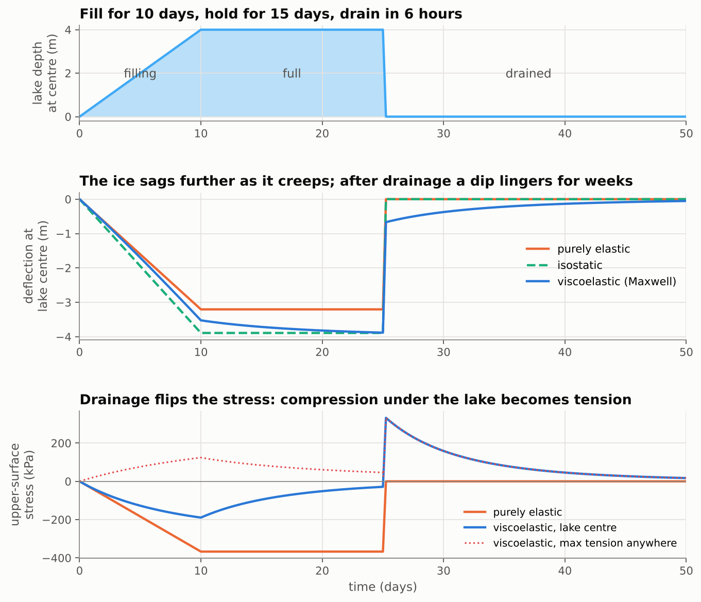

# Ice-shelf flexure under meltwater lakes: a 2-D viscoelastic beam model

When a meltwater lake fills on a floating ice shelf, its weight bends the ice.
This folder contains a small, fast, well-tested model of that bending. It
treats the shelf as a thin **Maxwell viscoelastic beam** floating on the ocean,
which acts as a **hydrostatic (Winkler) foundation**. The folder also contains
a step-by-step derivation with diagrams and a narrated explainer video.



| | |
|---|---|
| **Derivation (start here)** | [`derivation.md`](derivation.md): physics → master equation → limits → relaxation spectrum → numerics → verification, with diagrams at every step. Also as a PDF: [`derivation.pdf`](derivation.pdf) (rebuild with `python make_pdf.py`) |
| **Explainer video** | [`video/ice_shelf_flexure_explainer.mp4`](video/ice_shelf_flexure_explainer.mp4): Manim animation with a British-English voice-over and subtitles ([narration script](video/narration_script.md)) |
| **Tutorial notebook** | [`flexure_model_tutorial.ipynb`](flexure_model_tutorial.ipynb): how to use the model, every verification test from the derivation, the 2-D (map-view) plate extension including a real fill-spill-merge lake map, and a study of computation time |
| **Lake drainage** | [`lake_drainage_flexure.ipynb`](lake_drainage_flexure.ipynb): fill a REMA surface with fill-spill-merge, choose a lake, drain it and record how the shelf flexes back up (unloading only), saved as xarray/NetCDF |
| **Routing on a flexing shelf** | [`coupled_routing_flexure.ipynb`](coupled_routing_flexure.ipynb): fill-spill-merge and the plate run together through a melt season, each moving the other, compared with routing on a rigid shelf |
| **Drainage reorganisation** | [`drainage_reorganisation.ipynb`](drainage_reorganisation.ipynb): after a lake drains and the shelf rebounds, does next summer's water go back into the old basin or get redirected? (after Warner et al. 2021) |
| **Routing glue** | [`lake_routing.py`](lake_routing.py): DEM and mask loading, calls to the fill-spill-merge wrapper, lake labelling, a plate under the routing grid, the drainage and coupled experiments, drainage basins and overflow routes |
| **Model (1-D)** | [`viscoelastic_beam.py`](viscoelastic_beam.py): one file, NumPy and SciPy only. [`fast_beam.py`](fast_beam.py): the same time loop using banded LAPACK or Numba (5–20× less overhead per step) |
| **Model (2-D plate)** | [`viscoelastic_plate.py`](viscoelastic_plate.py): `SpectralPlate` (periodic, FFT, exact in time) and `FDPlate` (finite differences with clamped edges and a grounded-ice mask; sparse LU or preconditioned CG) |
| **Worked examples** | [`run_examples.py`](run_examples.py): writes the result figures in `figures/` |
| **Diagrams** | [`make_diagrams.py`](make_diagrams.py): writes the schematic figures in `figures/diagram_*.png` |
| **Tests** | [`tests/`](tests): 32 checks, mostly against exact solutions (beam: Hetényi, grounding line, free edge, Fourier modes, convergence; plate: Kelvin-function point load, beam limit, solver agreement, exact time integration, force balance; routing glue: volume conservation, rebound towards isostasy, restarts, drainage basins and overflow routes, water budgets of the coupled loop) |

## The model in one equation

The deflection $w(x,t)$ is positive downwards. In its simplest form, with one
relaxation time, it obeys this equation under a lake load $q = \rho_w g\,d(x,t)$:

$$
\Big(D\,\frac{\partial^4}{\partial x^4} + k\Big)\frac{\partial w}{\partial t}
= \frac{\partial q}{\partial t} + \frac{q - k\,w}{\tau},
\qquad D = \frac{EH^3}{12(1-\nu^2)},\quad k = \rho_{sw}g,\quad \tau = \frac{4\eta(1-\nu^2)}{E}.
$$

By default the model goes one step further. Ice is elastic with Poisson's ratio
$\nu = 0.3$, but it creeps without changing volume, so the viscous part has
$\nu_v = 0.5$ (`IceShelf.nu_v`). The bending moment then splits into an
isotropic part and a deviatoric part, with relaxation times
$\tau_1 = 6\eta(1-\nu)/E \approx 4.9$ days and $\tau_2 = 2\eta(1+\nu)/E \approx 3.0$ days.
Setting `nu_v = nu` recovers the single-time equation above exactly. The split
changes deflections by under 1% and stresses by up to ~20% (in map view).

* **On loading, the response is elastic** ($D w'''' + kw = q$). The dip spreads
  over a few flexural lengths $\ell = (D/k)^{1/4}$, which is about 600 m here.
* **Over a few days** the shelf relaxes towards **local isostasy**, $w = q/k$.
* **A feature of wavelength $\lambda$ relaxes on a timescale of roughly
  $\tau[1 + (2\pi\ell/\lambda)^4]$**, so narrow features relax slowest.
* **Draining a lake that has sat for a while flips the stress.** The surface
  under the old lake goes into tension.

## Quick start

```bash
pip install numpy scipy matplotlib pytest
cd flexure
python viscoelastic_beam.py   # parameters and a timing demo
python run_examples.py        # figures/*.png
python -m pytest -q           # 32 tests (the routing ones skip without fill-spill-merge)
```

```python
import numpy as np
from viscoelastic_beam import IceShelf, ViscoelasticBeam, parabolic_lake, SECONDS_PER_DAY

shelf = IceShelf(H=250, E=1e9, eta=1e14)        # SI units; nu = 0.3, nu_v = 0.5
x = np.linspace(0, 30e3, 3001)                  # grounding line at x = 0
beam = ViscoelasticBeam(x, shelf, left="clamped", right="free")
depth = parabolic_lake(x, centre=8e3, half_width=1.5e3, max_depth=4.0)
t = np.linspace(0, 30, 601) * SECONDS_PER_DAY
res = beam.run(t, lambda tt: shelf.lake_load(depth) * min(tt / (10 * SECONDS_PER_DAY), 1))
res                                   # an xarray.Dataset with dims (time, x)
res.w                                 # deflection [m], + down
res.sigma.sel(time_days=10, method="nearest")   # upper-surface stress [Pa], + = tension
res.to_netcdf("lake_run.nc")          # parameters are stored in res.attrs
```

All models return `xarray.Dataset`s: the 1-D beam over `(time, x)` and the
2-D plates over `(time, y, x)`, with stresses and the shelf parameters
included. Every model can also be stepped one interval at a time with
`start(q0)` then `advance(q1, dt)`, for coupling to other models such as
meltwater routing.

`load` can be any function `q(t)` or an array of shape `(nt, nx)`. `H` can be
an array, for a shelf of varying thickness. Boundary conditions can be
`'free'` (calving front or far field) or `'clamped'` (grounding line).

## Meltwater routing with fill-spill-merge

The three routing notebooks use the original fill-spill-merge algorithm
(Barnes, Callaghan & Wickert 2021) through the Python wrapper
[`jkingslake/fillspillmerge`](https://github.com/jkingslake/fillspillmerge).
Build the wrapper (it needs CMake, Boost and pybind11), then either install it
or tell `lake_routing.py` where it is:

```bash
export FILLSPILLMERGE_PATH=/path/to/fillspillmerge   # the folder holding fillspillmerge/ and build/
pip install rioxarray numba                          # numba is optional (fast drainage basins)
```

`lake_routing.py` also looks next to this repository, in `../fillspillmerge`
and `../fsm_pywrapper/fillspillmerge`. The notebooks use the 32 m REMA subset
`python/notebooks/rema_subsets/dem_small_2.tif`, averaged to 64 m for routing,
with a 128 m plate underneath and the grounded ice of
`data/Mask_Antarctica_v02.tif` held fixed. On this DEM the wrapper reproduces
the repository's reference result `fsm_results/rema_tests/test-wtd.tif` to
within float32 rounding.

```python
from lake_routing import load_dem, floating_mask, route, find_lakes, pick_lake, ShelfPlate, drain_lake, DAY
from viscoelastic_beam import IceShelf

dem = load_dem("../python/notebooks/rema_subsets/dem_small_2.tif", coarsen=2)
floating = floating_mask(dem)
water = route(dem, 0.5)                        # 0.5 m of melt everywhere -> water depth (DataArray)
labels, lakes = find_lakes(water, floating)    # lakes: an xarray.Dataset along dimension "lake"
lake = pick_lake(lakes)                        # or pick_lake(lakes, near=(x, y)) / pick_lake(lakes, lake=label)
plate = ShelfPlate(dem, floating, IceShelf(H=400.0))
resp = drain_lake(plate, water.where(labels == lake, 0), [0.5 * DAY, 30 * DAY, 365 * DAY])
resp.uplift                                    # (time, y, x) uplift after drainage [m]
```

In the coupled runs (`route_with_flexure`), `surface` is the ice surface (DEM minus deflection) and each saved
`water_depth` is in equilibrium with it at the same instant, so `surface + water_depth` is the water-surface
elevation. Outputs written by the notebooks go to `outputs/`, which git ignores.

## Numerics in brief

* **Space.** Second-order finite differences. Two sparse operators do the work:
  $L$ maps deflection to curvature and holds the kinematic boundary conditions;
  $L^*$ maps moment to force and holds the dynamic ones. The bending operator
  is $L^* D L$.
* **Time.** The trapezoidal (Crank–Nicolson) rule is applied to the Maxwell
  law and substituted into the force balance. This gives one constant
  pentadiagonal system, which is factorised once, so each step is an $O(N)$
  back-substitution.
* **Speed.** 3000 nodes × 1200 steps run in about one second.
* **Accuracy.** The scheme is second order in $\Delta x$ and $\Delta t$ and
  unconditionally stable, and the discrete force balance holds to round-off
  at every step.

## Rebuilding the video

```bash
pip install manim kokoro-onnx soundfile       # plus LaTeX and ffmpeg
# Kokoro TTS model files -> ~/kokoro (see video/voiceover.py)
cd flexure/video && ./render.sh               # or: ./render.sh low
```

The voice-over is synthesised offline with the open-weights
[Kokoro](https://github.com/thewh1teagle/kokoro-onnx) TTS model, using its
British English voice `bf_emma` with `en-gb` pronunciation.
