# Bending an ice shelf with meltwater: a 2-D viscoelastic beam model

This note derives, from scratch, a simple model of how a floating ice shelf
bends when a meltwater lake fills (and drains) on its surface, and then shows
how to solve it on a computer in a few lines. Every step comes with a picture.
The code is in [`viscoelastic_beam.py`](viscoelastic_beam.py). The figures come
from [`make_diagrams.py`](make_diagrams.py) and [`run_examples.py`](run_examples.py).

**The whole model in two lines.** The shelf is a thin Maxwell (spring-and-dashpot)
beam floating on sea water. The deflection $w(x,t)$, positive downwards, obeys

$$
\Big(D\,\frac{\partial^4}{\partial x^4} + k\Big)\frac{\partial w}{\partial t}
\;=\; \frac{\partial q}{\partial t} \;+\; \frac{q - k\,w}{\tau},
$$

where $q = \rho_w g\,d$ is the weight of a lake of depth $d$, $k=\rho_{sw}g$ is
the stiffness of buoyancy, $D$ is the flexural rigidity and $\tau$ is the
Maxwell relaxation time. When a lake first appears, the ice responds
**elastically**. Over a few days it relaxes towards **local isostasy**, $w = q/k$.

---

## Contents
1. [Set-up and assumptions](#1-set-up-and-assumptions)
2. [Buoyancy is a bed of springs](#2-buoyancy-is-a-bed-of-springs)
3. [Force balance on a slice](#3-force-balance-on-a-slice)
4. [Bending: curvature, strain and moment](#4-bending-curvature-strain-and-moment)
5. [Ice is a Maxwell material](#5-ice-is-a-maxwell-material)
6. [The master equation](#6-the-master-equation)
7. [Two limits: elastic and isostatic](#7-two-limits-elastic-and-isostatic)
8. [Which shapes relax first? The relaxation spectrum](#8-which-shapes-relax-first-the-relaxation-spectrum)
9. [Stresses, and why draining is dangerous](#9-stresses-and-why-draining-is-dangerous)
10. [Boundary conditions](#10-boundary-conditions)
11. [Numerics: fast and simple](#11-numerics-fast-and-simple)
12. [Verification](#12-verification)
13. [Limitations and easy extensions](#13-limitations-and-easy-extensions)
14. [Parameters and references](#14-parameters-and-references)

---

## 1. Set-up and assumptions

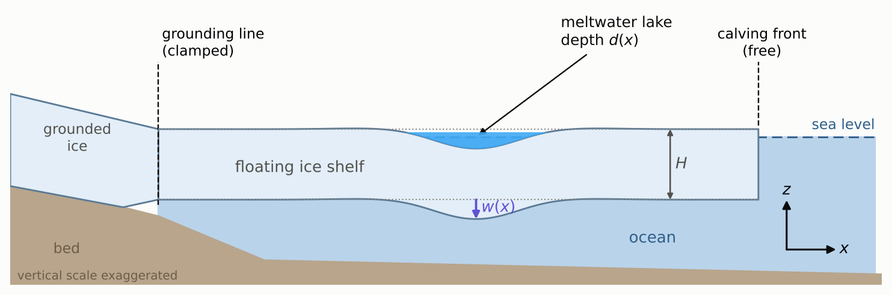

We take a vertical slice through the shelf along a line $x$ that runs from the
grounding line towards the calving front. $z$ points up. The shelf has
thickness $H$, floats in sea water, and carries a lake of water depth $d(x,t)$.
The lake's weight pushes the shelf down by $w(x,t)$, measured **positive
downwards**. The change in surface elevation is therefore $-w$.

We assume the following:

| assumption | why it is reasonable |
|---|---|
| **2-D, plane strain.** Nothing varies along the third direction $y$, so the lake is a long trough. | It keeps the maths one-dimensional. A circular lake gives similar numbers (see §13). |
| **Thin beam.** Plane cross-sections stay plane. | Lakes are 1 to 5 km across and $H \approx 100$ to $500$ m. |
| **Small deflections.** $w \ll H$, small slopes. | $w$ is a few metres. |
| **Linear Maxwell rheology.** | This is the simplest material that is elastic over hours and viscous over weeks. |
| **Hydrostatic ocean.** Sea water pushes back like a bed of springs. | Lakes fill and drain over hours to weeks, much slower than ocean waves. |
| **Prescribed load** $q = \rho_w g d(x,t)$. | We specify the water and do not route it (see §13). |
| **No stretching or flow of the shelf.** | Bending happens much faster than the shelf spreads. |

Everything is linear in the **perturbation**. The background weight of the ice
is already balanced by the background buoyancy, so only the extra load $q$ and
the extra deflection $w$ appear.

---

## 2. Buoyancy is a bed of springs

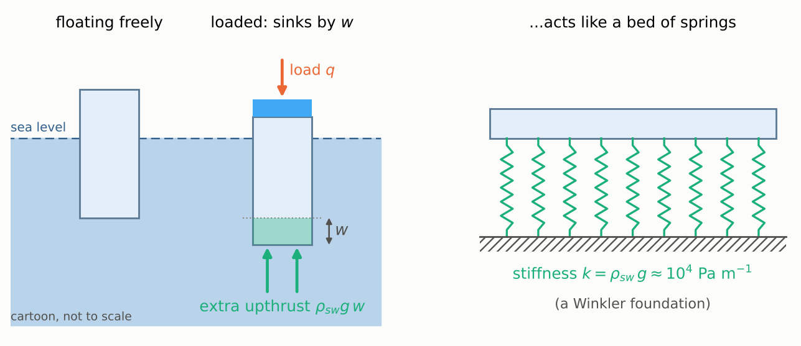

Push a floating column down by $w$ and it displaces an extra $w$ of sea water
per unit area. Archimedes then gives an extra upward pressure

$$
p_{\text{buoy}} = \rho_{sw}\, g\, w \;\equiv\; k\,w ,\qquad k = \rho_{sw} g \approx 1.0\times10^4\ \text{Pa m}^{-1}.
$$

This acts exactly like a bed of independent springs with stiffness $k$, which
is called a *Winkler foundation*. The spring is the ocean, not the ice.

A useful by-product: if nothing else resisted, a lake of depth $d$ would sink
the ice by

$$
w_{\text{iso}} = \frac{q}{k} = \frac{\rho_w}{\rho_{sw}}\,d \approx 0.97\,d .
$$

---

## 3. Force balance on a slice

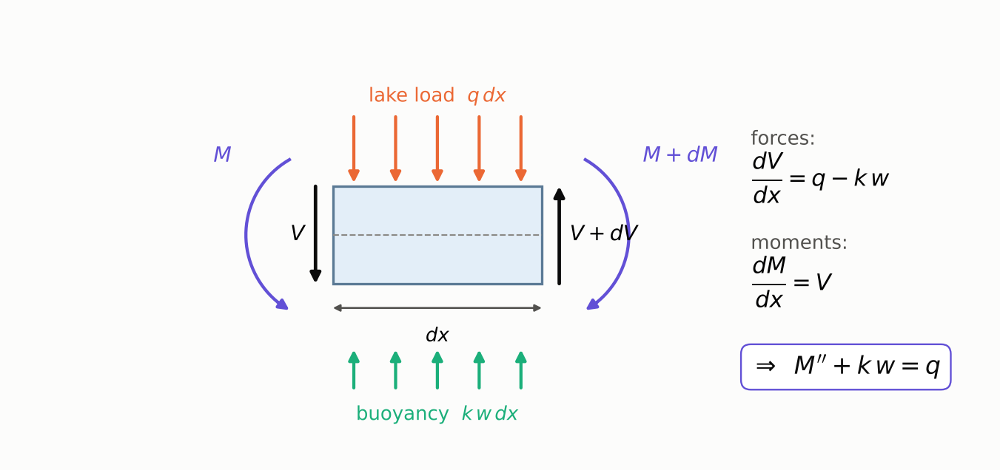

Cut out a slice of width $dx$. Four things act on it:

* the lake load $q\,dx$, pushing down;
* buoyancy $k\,w\,dx$, pushing up;
* shear forces $V$ and $V+dV$ on its two faces, which come from the neighbouring ice;
* bending moments $M$ and $M+dM$ on its two faces.

**Vertical forces** must balance: $\;dV = (q - k w)\,dx$.
**Moments** must balance (taken about the left face, ignoring tiny $dx^2$ terms): $\;dM = V\,dx$.
Eliminating $V$ gives the equilibrium equation

$$
\boxed{\;\frac{\partial^2 M}{\partial x^2} + k\,w = q\;}
\tag{1}
$$

In words: wherever the lake is not held up by buoyancy, the ice must carry the
difference through changes in its bending moment.

---

## 4. Bending: curvature, strain and moment

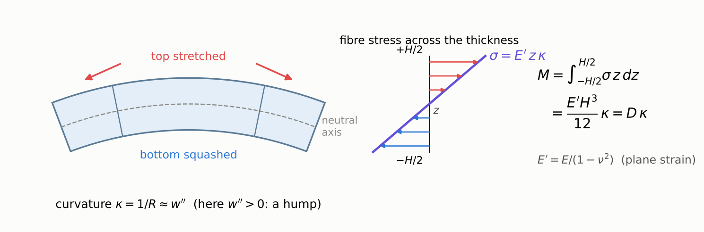

When the beam bends, cross-sections stay straight but tilt. A fibre at height $z$
above the mid-plane (the *neutral axis*) is stretched in proportion to its
distance from it:

$$
\varepsilon(z) = z\,\kappa ,\qquad \kappa = \frac{\partial^2 w}{\partial x^2}\quad\text{(the curvature)}.
$$

With $w$ positive down, $\kappa>0$ means a hump. The top is stretched (tension)
and the bottom squashed. Under the middle of a lake the ice sags, so
$\kappa<0$ and the top is in compression.

The **bending moment** is the turning effect of all the fibre stresses
$\sigma(z)$:

$$
M = \int_{-H/2}^{H/2} \sigma(z)\, z \, dz .
$$

For an **elastic** beam in plane strain, $\sigma = E'\varepsilon$ with
$E' = E/(1-\nu^2)$. So

$$
M = E'\kappa \int_{-H/2}^{H/2} z^2\,dz = \frac{E' H^3}{12}\,\kappa \equiv D\,\kappa,
\qquad D = \frac{E H^3}{12(1-\nu^2)} .
$$

$D$ is the **flexural rigidity**. It scales as $H^3$, so a shelf twice as thick
is eight times as stiff.

For a **viscous** beam, stress depends on strain *rate*. For an incompressible
Newtonian fluid of viscosity $\eta$ in plane strain with $\sigma_{zz}\approx 0$,
this is $\sigma = 4\eta\,\dot\varepsilon$. The same integral gives

$$
M = \frac{4\eta H^3}{12}\,\dot\kappa \equiv \Lambda\,\dot\kappa,\qquad \Lambda = \frac{\eta H^3}{3} .
$$

$\Lambda$ is a "viscous flexural rigidity".

---

## 5. Ice is a Maxwell material

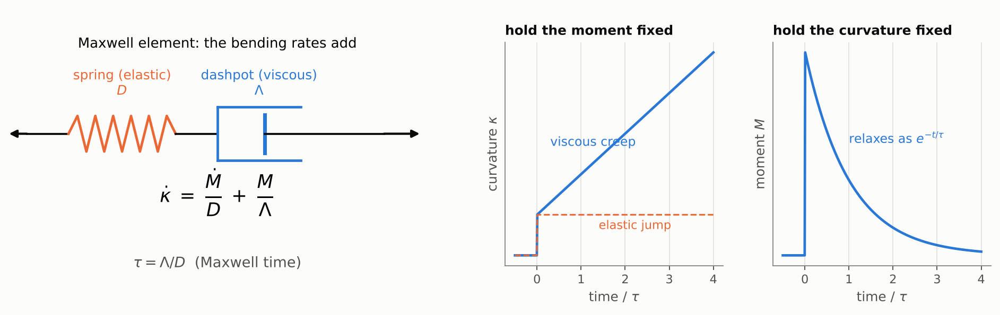

Over minutes to hours, ice behaves like a spring. Over days to weeks it creeps
like a very stiff fluid. The simplest model that does both is a **Maxwell
element**, a spring and a dashpot in series. Each fibre obeys
$\dot\varepsilon = \dot\sigma/E' + \sigma/4\eta$. Multiply by $z$ and integrate
across the thickness, exactly as above, and the *bending* rates simply add:

$$
\boxed{\;\dot\kappa = \frac{\dot M}{D} + \frac{M}{\Lambda}\;}
\qquad\Longleftrightarrow\qquad
\dot M = D\,\dot\kappa - \frac{M}{\tau},
\tag{2}
$$

with the **Maxwell time**

$$
\tau = \frac{\Lambda}{D} = \frac{4\eta(1-\nu^2)}{E} .
$$

For $\nu\to\tfrac12$ this becomes the familiar $\eta/G$, where $G$ is the shear
modulus. With $E = 1$ GPa and $\eta = 10^{14}$ Pa s, $\tau \approx 4.2$ days.
The right-hand plots show the two classic experiments:

* **Hold $M$ fixed.** $\kappa$ jumps elastically and then creeps linearly.
* **Hold $\kappa$ fixed.** $M$ jumps and then relaxes as $e^{-t/\tau}$.

A useful mental picture is an **elastic beam whose stress-free shape slowly
drifts towards whatever shape it is being held in**.

---

## 6. The master equation

Now combine the force balance (1) and the material law (2). Take $\partial^2/\partial x^2$
of (2), use (1) to replace $M''$ by $q-kw$, and use (1) differentiated in
time, $\dot M'' = \dot q - k\dot w$:

$$
\dot q - k\,\dot w \;=\; D\,\frac{\partial^4\dot w}{\partial x^4} \;-\; \frac{q - k w}{\tau}
$$

Rearranged:

$$
\boxed{\;\Big(D\,\frac{\partial^4}{\partial x^4} + k\Big)\frac{\partial w}{\partial t}
= \frac{\partial q}{\partial t} + \frac{q - k\,w}{\tau}\;}
\tag{3}
$$

Read it left to right:

* The operator in brackets is the **elastic** beam-on-springs operator.
* $\partial q/\partial t$ is the **instantaneous elastic** response to any change in load.
* $(q-kw)/\tau$ is the **creep** term. Wherever buoyancy is not yet carrying the
  lake ($kw\neq q$), the ice creeps at a rate set by $\tau$, and it stops only
  when $kw = q$.

---

## 7. Two limits: elastic and isostatic

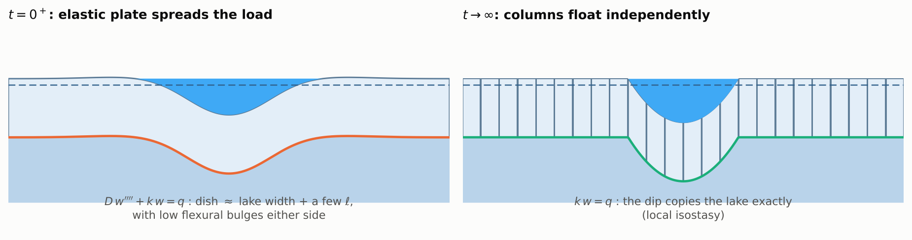

**At $t = 0^+$ the response is elastic.** Integrate (3) across the instant the
load appears. The creep term is finite, so it contributes nothing in zero time,
and we are left with

$$
D\,\frac{\partial^4 w}{\partial x^4} + k\,w = q .
$$

This is the classic "beam on elastic foundation" (Hetényi, 1946). Its natural
length scale is the **flexural length**

$$
\ell = \left(\frac{D}{k}\right)^{1/4} \approx 610\ \text{m}\quad(H = 250\ \text{m},\ E = 1\ \text{GPa}).
$$

For a line load $P$ the solution is
$w = \frac{P\beta}{2k}\,e^{-\beta|x|}\big(\cos\beta|x| + \sin\beta|x|\big)$, with $\beta = 1/(\sqrt2\,\ell)$.

* The dip is spread over a few flexural lengths.
* It crosses zero at $|x| = 3\pi\ell/(2\sqrt2) \approx 3.3\ell$.
* A low **flexural bulge** peaks at $|x| = \sqrt2\,\pi\,\ell \approx 4.4\ell$, with
  height $e^{-\pi}\approx 4\%$ of the central dip.

Our 3 km-wide, 4 m-deep lake sinks the centre by 3.2 m at first, instead of 3.9 m.

**As $t\to\infty$ the response is isostatic.** The left side of (3) goes to zero
when nothing changes any more, so $q = k w$. The ice "forgets" its stiffness
and floats as independent columns. The dip copies the lake exactly, and the
bending moment relaxes to zero.

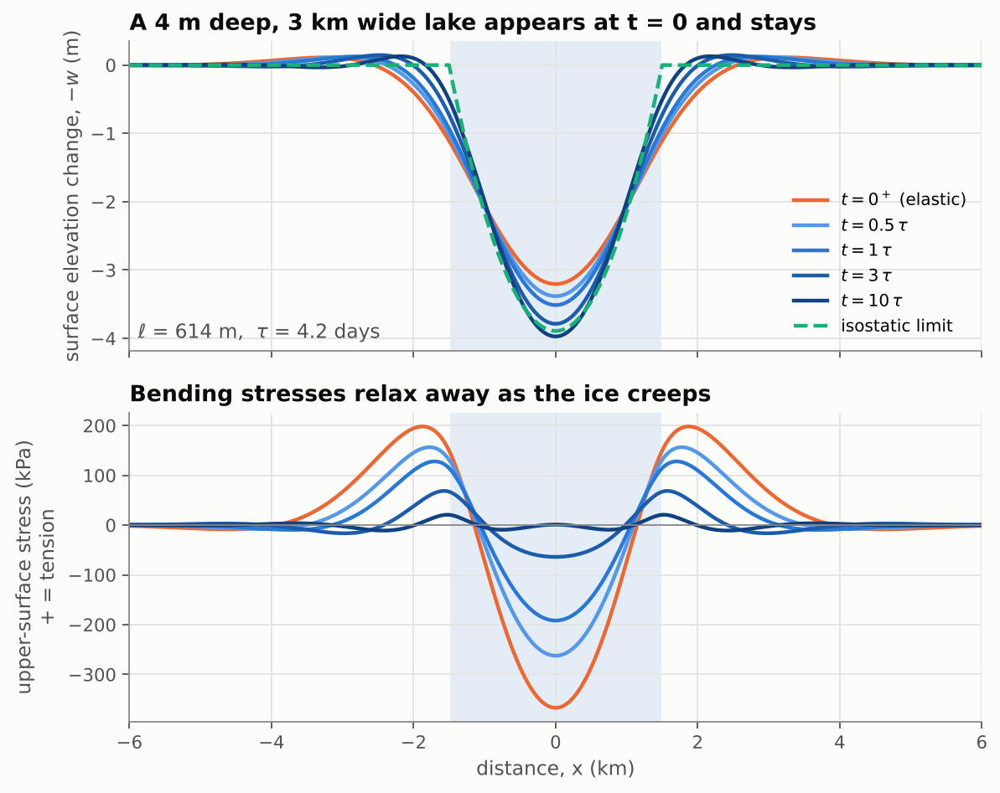

*A lake appears at $t=0$ and is left there. The orange curve is the elastic
response. The blue curves (light to dark) show the ice creeping towards the
dashed isostatic shape. The bending stresses (bottom panel) decay as it does.*

---

## 8. Which shapes relax first? The relaxation spectrum

Because (3) is linear with constant coefficients, each sinusoid in $x$ evolves
on its own. Put $w = \hat w(t)\cos k_x x$ and $q = \hat q\cos k_x x$, with
$\hat q$ switched on at $t=0$. Then (3) becomes an ordinary differential equation
with the solution

$$
\hat w(t) = \underbrace{\frac{\hat q}{k}}_{\text{isostatic}}
+ \Big(\underbrace{\frac{\hat q}{Dk_x^4+k}}_{\text{elastic}} - \frac{\hat q}{k}\Big)\,e^{-t/\tau_\lambda},
\qquad
\boxed{\;\tau_\lambda = \tau\big[1 + (k_x\ell)^4\big] = \tau\Big[1 + \Big(\frac{2\pi\ell}{\lambda}\Big)^4\Big]\;}
$$

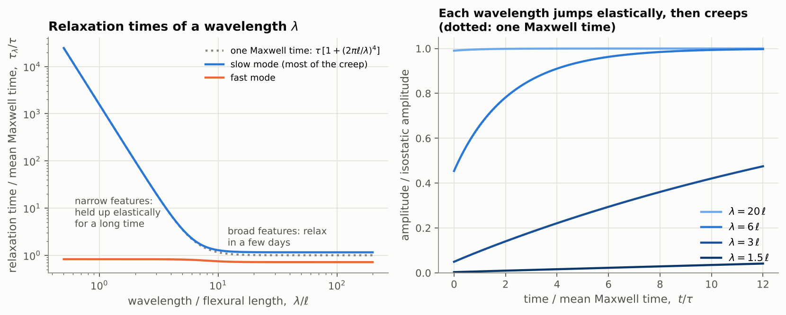

* **Broad features** ($\lambda \gg 2\pi\ell$) are barely supported by bending in
  the first place. They are already nearly isostatic, and what is left relaxes
  in about one Maxwell time.
* **Narrow features** ($\lambda \lesssim 2\pi\ell$) are held up mainly by the
  ice's stiffness. They relax extremely slowly, as $(2\pi\ell/\lambda)^4$.
  On a 250 m-thick shelf, a 2 km-wavelength wiggle takes about two months to
  relax and a 1 km one takes more than two years.

This also tells us that the problem is **not stiff** numerically. The fastest
decay rate of any mode is $1/\tau$, so a time step of a fraction of $\tau$ is
enough for every wavelength.

---

## 9. Stresses, and why draining is dangerous

The bending stress is largest at the upper surface, where crevasses open:

$$
\sigma_{\text{top}} = \frac{6M}{H^2}\qquad(\text{positive} = \text{tension}).
$$

For the 4 m-deep, 3 km-wide lake:

* The elastic response puts the surface under the lake centre into compression of about $-370$ kPa.
* A ring of **tension, about $+200$ kPa**, sits just outside the lake shore.
* These stresses are of the same order as those usually needed to open surface
  crevasses, roughly 100 kPa or more (e.g. Vaughan, 1993).

This is the "ring fracture" mechanism proposed for the 2002 Larsen B break-up
(Banwell et al., 2013).

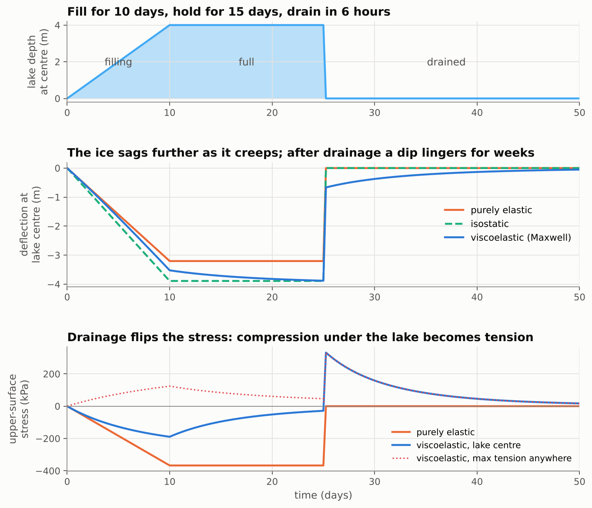

The viscoelastic twist comes with **drainage**:

* **While the lake sits**, the moments relax ($M\to 0$). The ice "gets used to"
  being bent.
* **When the lake drains** in hours (for example by hydrofracture), the load
  vanishes much faster than $\tau$. The response to *removing* the load is
  again elastic, and equal and opposite to the original elastic response.
  Superposed on a relaxed state, this leaves the ice **bent upwards**, with the
  surface under the former lake now in **tension (+330 kPa)**.
* A dip of about 0.7 m lingers at the old lake site and creeps away over the
  following weeks.

Repeated fill-drain cycles therefore reverse the stress at the lake centre
again and again. This fatigue-like loading is what the model was built to
explore (compare MacAyeal & Sergienko, 2013; Banwell et al., 2019).

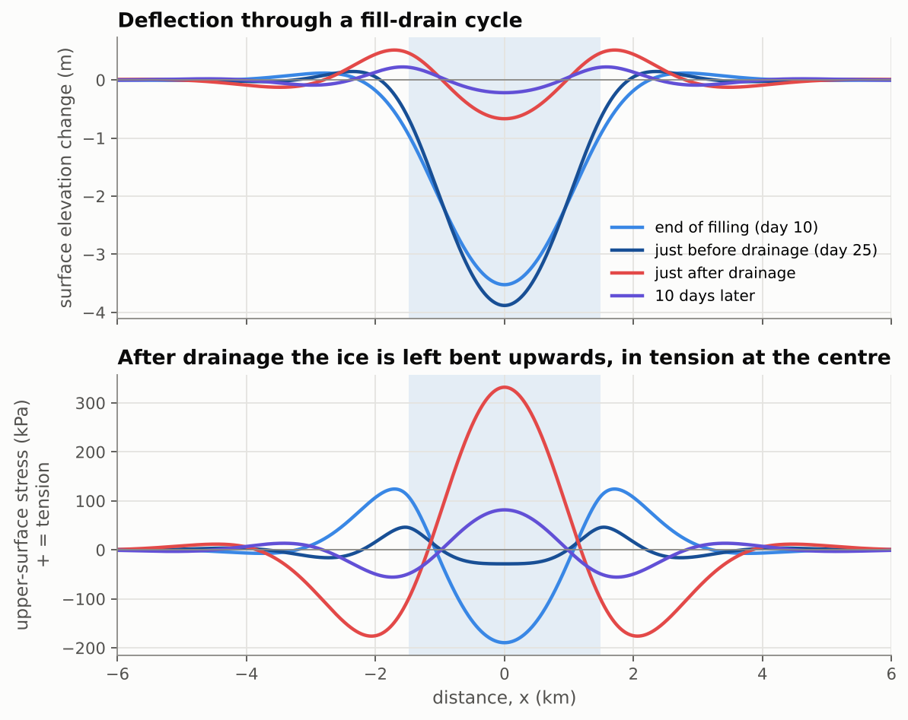

---

## 10. Boundary conditions

The beam equation is fourth order, so each end needs **two** conditions.

| end | physical meaning | conditions | type |
|---|---|---|---|
| **grounding line** | ice frozen to the bed: no deflection, no tilt | $w = 0,\;\; \partial w/\partial x = 0$ ("clamped") | kinematic: on $w$ |
| **calving front** | nothing holds the end | $M = 0,\;\; V = \partial M/\partial x = 0$ ("free") | dynamic: on $M$ |

The free-end conditions are on $M$, not directly on $w$. For a Maxwell beam
that starts from rest, $M = 0$ for all time implies $\partial^2 w/\partial x^2 = 0$
for all time, and similarly for the third derivative, so the elastic intuition carries over.

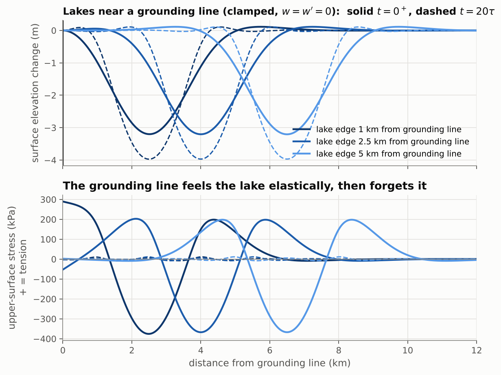

*Lakes 1, 2.5 and 5 km from a clamped grounding line. A lake within about
$2\ell$ of the grounding line strains it elastically: here, +290 kPa of surface
tension at the grounding line for the closest lake. That stress relaxes away
(dashed curves) as the shelf creeps.*

---

## 11. Numerics: fast and simple

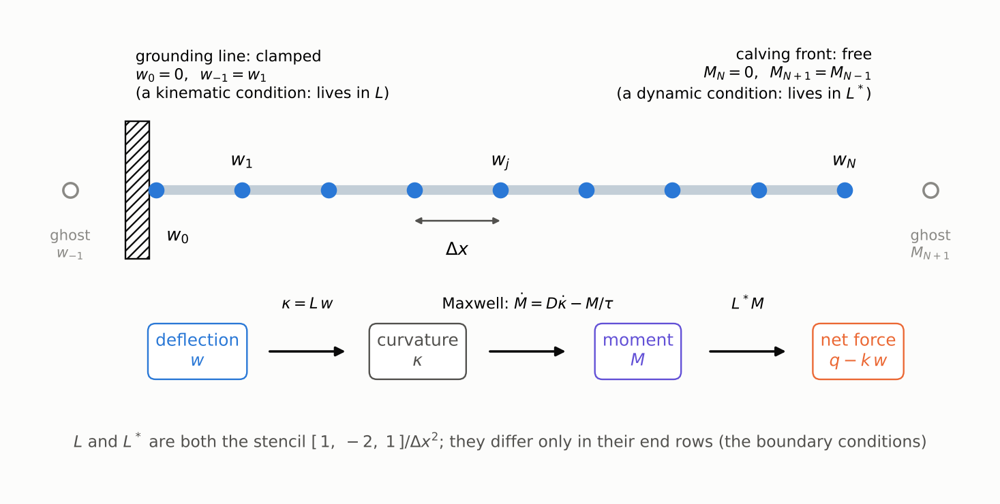

### Space: two little matrices

Put $N$ equally spaced nodes $x_j$ along the beam, with spacing $\Delta x$, and
store $w_j$ and $M_j$ at each node. The physics is a chain of three steps:

$$
w \;\xrightarrow{\;L\;}\; \kappa \;\xrightarrow{\;\text{Maxwell}\;}\; M \;\xrightarrow{\;L^*\;}\; \text{net force } (q - k w).
$$

Both $L$ and $L^*$ are the familiar second-difference stencil
$[\,1,\,-2,\,1\,]/\Delta x^2$. They differ **only in their end rows**, which is
where the boundary conditions live:

| end type | row of $L$ (curvature from $w$) | row of $L^*$ (force from $M$) |
|---|---|---|
| clamped (node 0) | ghost $w_{-1}=w_1$: $\;\kappa_0 = (2w_1-2w_0)/\Delta x^2$ | not used: the equation is replaced by $w_0 = 0$ |
| free (node 0) | not used: zeros, so $M_0 \equiv 0$ | ghost $M_{-1}=M_1$: $\;f_0 = (2M_1-2M_0)/\Delta x^2$ |

Kinematic conditions go in $L$ and dynamic ones go in $L^*$. The fourth
derivative is never written down explicitly. It is just $L^* D\, L$, so a
spatially varying $D(x)$ (a thinning shelf) costs nothing extra.

### Time: the trapezoidal rule, then one linear solve

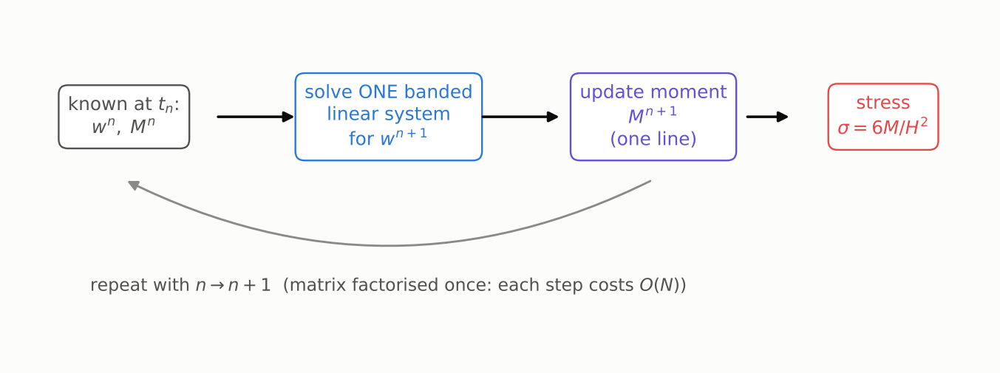

Step from $t_n$ to $t_{n+1} = t_n + \Delta t$. Write $a = \Delta t/\tau$.

**1. Moment update.** Apply the trapezoidal (Crank–Nicolson) rule to the
Maxwell law $\dot M = D L\dot w - M/\tau$ at every node:

$$
M^{n+1} = c\,\Big[(1-\tfrac a2)\,M^n + D\,L\,(w^{n+1}-w^n)\Big],\qquad c = \frac{1}{1 + a/2}.
$$

**2. Deflection solve.** Substitute this into the force balance at the new
time, $L^*M^{n+1} + k\,w^{n+1} = q^{n+1}$. This gives **one linear system** for
the new deflection:

$$
\big(\underbrace{L^* cD\,L + k\,I}_{\text{constant, pentadiagonal}}\big)\,w^{n+1}
= q^{n+1} + L^* cD\,L\,w^n - L^*\big[c\,(1-\tfrac a2)\,M^n\big].
$$

**3. Repeat.** Solve step 2 for $w^{n+1}$, then evaluate step 1 for $M^{n+1}$.

That is the entire algorithm. In the code it reads:

```python
def step(self, w0, M0, q1, dt):
    lu, S, c, a = self._step_matrices(dt)          # S = L* (c D) L, factorised once
    rhs = q1 + S @ w0 - self.Lstar @ (c * (1 - a/2) * M0)
    w1 = self._solve(lu, rhs)                       # one banded back-substitution
    M1 = c * ((1 - a/2) * M0 + self.D * (self.L @ (w1 - w0)))
    return w1, M1
```

### Why this is a good scheme

* **Fast.** The matrix never changes, so it is factorised once. Each step is
  then one banded back-substitution costing $O(N)$. 3000 nodes × 1200 steps
  take about one second in pure Python and SciPy.
* **Exact elastic limit.** With $\Delta t/\tau \to 0$ it reduces to the elastic
  solve, so instantaneous loading and unloading are captured exactly.
* **Second-order accurate** in both $\Delta x$ and $\Delta t$, and
  **unconditionally stable**: the trapezoidal rule is A-stable.
* **Force balance holds to round-off at every step.** The two operators are used
  consistently, so the discrete version of (1) is satisfied exactly, and the
  stresses are physically consistent.
* **Choosing steps.** $\Delta x \lesssim \ell/10$ and $\Delta t \lesssim \tau/10$
  give errors well below 0.1 % (see the convergence panel below).

---

## 12. Verification

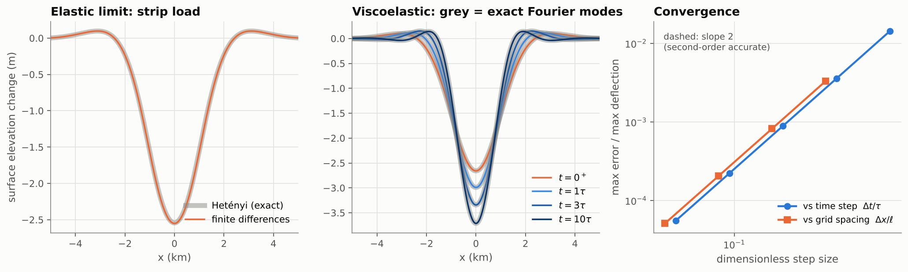

The test-suite ([`tests/test_viscoelastic_beam.py`](tests/test_viscoelastic_beam.py),
run with `python -m pytest -q`) checks the model against exact solutions:

| test | exact solution | agreement |
|---|---|---|
| elastic strip load, free beam | Hetényi (1946) | < 0.2 % |
| line load at a free calving front | $w = \frac{2P\beta}{k}e^{-\beta x}\cos\beta x$ | < 0.2 % |
| uniform load, clamped grounding line | $w = \frac{q}{k}\big[1 - e^{-\beta x}(\cos\beta x + \sin\beta x)\big]$ (the tidal-flexure profile) | < 0.1 % |
| viscoelastic relaxation of a lake | exact Fourier-mode solution (§8) | < 0.2 % |
| long-time limit | local isostasy $w = q/k$, $M\to0$ | ✓ |
| uniform load on a free beam | no bending at all | to round-off |
| discrete force balance $L^*M + kw = q$ | (all boundary-condition combinations) | to round-off |
| time convergence | slope 2 | ✓ |

---

## 13. Limitations and easy extensions

* **Lake–flexure feedback.** Here the water depth is prescribed. In reality the
  lake sits in the depression it creates. Coupling the model to the
  fill-spill-merge routing in [`../python`](../python) would let water and ice
  shape each other.
* **Variable thickness.** This already works: pass `H` as an array. Both $D$
  and $\Lambda$ scale as $H^3$, so $\tau$ is unchanged.
* **Lakes in map view.** This is implemented in
  [`viscoelastic_plate.py`](viscoelastic_plate.py): the same physics with
  $\partial^4/\partial x^4 \to \nabla^4$ gives a viscoelastic plate. A round
  lake sinks less than a long trough at first, and the ring of tension survives.
  See Part 3 of [`flexure_model_tutorial.ipynb`](flexure_model_tutorial.ipynb).
* **Nonlinear (Glen's law) creep and depth-varying temperature.** Here
  $\eta$ depends on stress and depth, so $\Lambda$ becomes a function of the
  state. The moment update becomes a local nonlinear update; the solve stays
  the same.
* **Membrane stresses and ice-shelf flow.** These are neglected, which is fine
  for bending over days to weeks. For coupled flow and flexure see
  MacAyeal et al. (2021).
* **Fracture.** The model reports stresses but does not break.

---

## 14. Parameters and references

| symbol | meaning | default |
|---|---|---|
| $H$ | ice thickness | 250 m |
| $E$ | effective Young's modulus (tidal-flexure studies infer about 1 GPa, well below the laboratory 9 GPa; e.g. Vaughan, 1995) | 1 GPa |
| $\nu$ | Poisson's ratio | 0.3 |
| $\eta$ | ice viscosity | $10^{14}$ Pa s |
| $\rho_i,\ \rho_{sw},\ \rho_w$ | ice, sea water, meltwater densities | 917, 1028, 1000 kg m⁻³ |
| $D = EH^3/12(1-\nu^2)$ | flexural rigidity | $1.4\times10^{15}$ N m |
| $k = \rho_{sw}g$ | buoyancy stiffness | $1.0\times10^4$ Pa m⁻¹ |
| $\ell = (D/k)^{1/4}$ | flexural length | 614 m |
| $\tau = 4\eta(1-\nu^2)/E$ | Maxwell time | 4.2 days |

The values of $E$ and especially $\eta$ are uncertain by an order of magnitude
or more. Treat the numbers above as illustrative. Because $\ell \propto E^{1/4}H^{3/4}$
and $\tau \propto \eta/E$, it is easy to rescale the results.

* Banwell, A. F., MacAyeal, D. R., & Sergienko, O. V. (2013). Breakup of the Larsen B Ice Shelf triggered by chain reaction drainage of supraglacial lakes. *Geophysical Research Letters*, 40, 5872–5876.
* Banwell, A. F., Willis, I. C., Macdonald, G. J., Goodsell, B., & MacAyeal, D. R. (2019). Direct measurements of ice-shelf flexure caused by surface meltwater ponding and drainage. *Nature Communications*, 10, 730.
* Hetényi, M. (1946). *Beams on Elastic Foundation*. University of Michigan Press.
* Holdsworth, G. (1969). Flexure of a floating ice tongue. *Journal of Glaciology*, 8(54), 385–397.
* MacAyeal, D. R., & Sergienko, O. V. (2013). The flexural dynamics of melting ice shelves. *Annals of Glaciology*, 54(63), 1–10.
* MacAyeal, D. R., Sergienko, O. V., Banwell, A. F., Macdonald, G. J., Willis, I. C., & Stevens, L. A. (2021). Treatment of ice-shelf evolution combining flow and flexure. *Journal of Glaciology*, 67(265), 885–902.
* Reeh, N., Christensen, E. L., Mayer, C., & Olesen, O. B. (2003). Tidal bending of glaciers: a linear viscoelastic approach. *Annals of Glaciology*, 37, 83–89.
* Turcotte, D. L., & Schubert, G. (2014). *Geodynamics* (3rd ed.). Cambridge University Press.
* Vaughan, D. G. (1993). Relating the occurrence of crevasses to surface strain rates. *Journal of Glaciology*, 39(132), 255–266.
* Vaughan, D. G. (1995). Tidal flexure at ice shelf margins. *Journal of Geophysical Research*, 100(B4), 6213–6224.
