# Bending an ice shelf with meltwater: a 2-D viscoelastic beam model

This note derives, from scratch, a simple model of how a floating ice shelf
bends when a meltwater lake fills (and drains) on its surface, and then shows
how to solve it on a computer in a few lines. Every step comes with a picture.
The code is in [`viscoelastic_beam.py`](viscoelastic_beam.py). The figures come
from [`make_diagrams.py`](make_diagrams.py) and [`run_examples.py`](run_examples.py).

**The whole model in two lines.** The shelf is a thin Maxwell (spring-and-dashpot)
beam floating on sea water. In its simplest form the deflection $w(x,t)$,
positive downwards, obeys

$$
\Big(D\,\frac{\partial^4}{\partial x^4} + k\Big)\frac{\partial w}{\partial t}
\;=\; \frac{\partial q}{\partial t} \;+\; \frac{q - k\,w}{\tau},
$$

where $q = \rho_w g\,d$ is the weight of a lake of depth $d$, $k=\rho_{sw}g$ is
the stiffness of buoyancy, $D$ is the flexural rigidity and $\tau$ is the
Maxwell relaxation time. When a lake first appears, the ice responds
**elastically**. Over a few days it relaxes towards **local isostasy**, $w = q/k$.

The model actually solved goes one step further. Ice creeps without changing
volume, so its viscous Poisson's ratio is ½, while its elastic one is about
0.3. That splits the bending moment into two parts with relaxation times of
4.9 and 3.0 days (§5). The equation above is the special case where the two
Poisson's ratios are equal. The split changes deflections by less than 1% and
stresses by up to about 20% (in map view).

---

**Version 2.** This edition adds material from the working sessions on the derivation: the sign conventions and a free-end check (§3); the geometric origin of $\varepsilon = z\kappa$, the plane-strain modulus, and the naming of $D$ (§4); a step-by-step derivation of the viscous factor $4\eta$ (§4); why the Maxwell rates add in series (§5); the assumptions behind the master equation (§6); a step-by-step derivation of the relaxation spectrum, a comparison of the Fourier and real-space routes, and a worked code block (§8); and the thin-plate caveat for narrow lakes (§8, §13). No equation in §1–§7 or §9–§14 has changed.

---

## Contents
1. [Set-up and assumptions](#1-set-up-and-assumptions)
2. [Buoyancy is a bed of springs](#2-buoyancy-is-a-bed-of-springs)
3. [Force balance on a slice](#3-force-balance-on-a-slice)
4. [Bending: curvature, strain and moment](#4-bending-curvature-strain-and-moment)
5. [Ice is a Maxwell material](#5-ice-is-a-maxwell-material)
6. [The master equation](#6-the-master-equation)
7. [Two limits: elastic and isostatic](#7-two-limits-elastic-and-isostatic)
8. [Which shapes relax first? The relaxation spectrum](#8-which-shapes-relax-first-the-relaxation-spectrum)
9. [Stresses, and why draining is dangerous](#9-stresses-and-why-draining-is-dangerous)
10. [Boundary conditions](#10-boundary-conditions)
11. [Numerics: fast and simple](#11-numerics-fast-and-simple)
12. [Verification](#12-verification)
13. [Limitations and easy extensions](#13-limitations-and-easy-extensions)
14. [Parameters and references](#14-parameters-and-references)

---

## 1. Set-up and assumptions

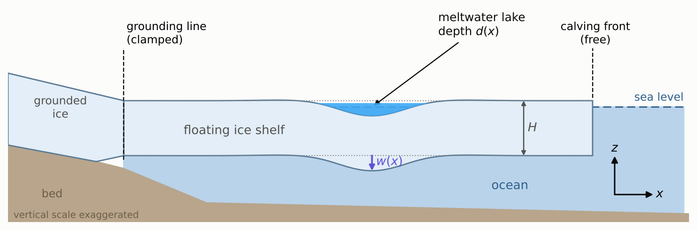

We take a vertical slice through the shelf along a line $x$ that runs from the
grounding line towards the calving front. $z$ points up. The shelf has
thickness $H$, floats in sea water, and carries a lake of water depth $d(x,t)$.
The lake's weight pushes the shelf down by $w(x,t)$, measured **positive
downwards**. The change in surface elevation is therefore $-w$.

We assume the following:

| assumption | why it is reasonable |
|---|---|
| **2-D, plane strain.** Nothing varies along the third direction $y$, so the lake is a long trough. | It keeps the maths one-dimensional. A circular lake gives similar numbers (see §13). |
| **Thin beam.** Plane cross-sections stay plane. | Lakes are 1 to 5 km across and $H \approx 100$ to $500$ m. |
| **Small deflections.** $w \ll H$, small slopes. | $w$ is a few metres. |
| **Linear Maxwell rheology.** | This is the simplest material that is elastic over hours and viscous over weeks. |
| **Hydrostatic ocean.** Sea water pushes back like a bed of springs. | Lakes fill and drain over hours to weeks, much slower than ocean waves. |
| **Prescribed load** $q = \rho_w g d(x,t)$. | We specify the water and do not route it (see §13). |
| **No stretching or flow of the shelf.** | Bending happens much faster than the shelf spreads. |

Everything is linear in the **perturbation**. The background weight of the ice
is already balanced by the background buoyancy, so only the extra load $q$ and
the extra deflection $w$ appear.

---

## 2. Buoyancy is a bed of springs

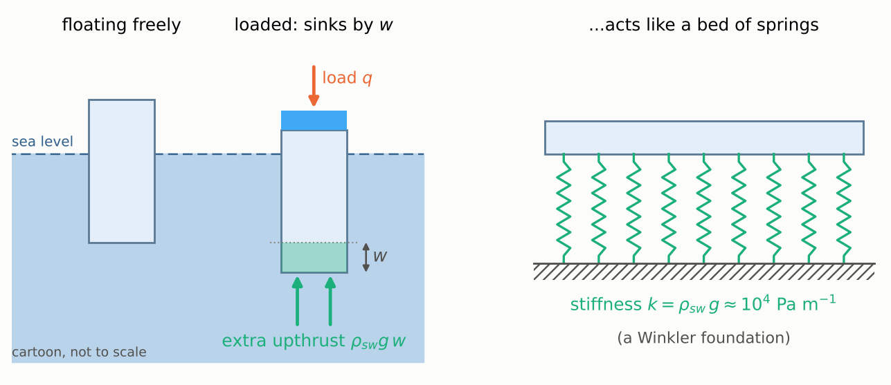

Push a floating column down by $w$ and it displaces an extra $w$ of sea water
per unit area. Archimedes then gives an extra upward pressure

$$
p_{\text{buoy}} = \rho_{sw}\, g\, w \;\equiv\; k\,w ,\qquad k = \rho_{sw} g \approx 1.0\times10^4\ \text{Pa m}^{-1}.
$$

This acts exactly like a bed of independent springs with stiffness $k$, which
is called a *Winkler foundation*. The spring is the ocean, not the ice.

A useful by-product: if nothing else resisted, a lake of depth $d$ would sink
the ice by

$$
w_{\text{iso}} = \frac{q}{k} = \frac{\rho_w}{\rho_{sw}}\,d \approx 0.97\,d .
$$

---

## 3. Force balance on a slice

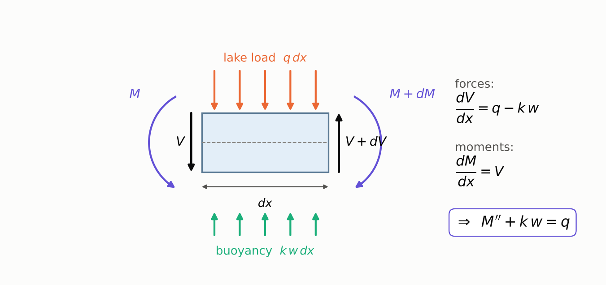

Cut out a slice of width $dx$. Four things act on it:

* the lake load $q\,dx$, pushing down;
* buoyancy $k\,w\,dx$, pushing up;
* shear forces $V$ and $V+dV$ on its two faces, which come from the neighbouring ice;
* bending moments $M$ and $M+dM$ on its two faces.

**Vertical forces** must balance: $\;dV = (q - k w)\,dx$.
**Moments** must balance (taken about the left face, ignoring tiny $dx^2$ terms): $\;dM = V\,dx$.
Eliminating $V$ gives the equilibrium equation

$$
\boxed{\;\frac{\partial^2 M}{\partial x^2} + k\,w = q\;}
\tag{1}
$$

In words: wherever the lake is not held up by buoyancy, the ice must carry the
difference through changes in its bending moment.

---

### Sign conventions, and a free-end check

Throughout, $w$ is positive downwards and $z$ is positive upwards. The shear force $V$ and moment $M$ are defined so that

$$
\frac{\partial M}{\partial x} = V, \qquad \frac{\partial V}{\partial x} = q - k\,w .
$$

Only these two relations matter. Which face's shear is called "positive" is a choice of convention. The equations, not a picture of rotation, fix the sign. (Earlier working notes used sagging-positive curvature and moment, which flips the signs of $M$ and $V$ but not the physics.)

**A check.** Take a free end at $x=0$, so $M(0)=V(0)=0$, with no buoyancy and a downward load $q>0$. Then

$$
V(x) = qx, \qquad M(x) = \tfrac12 q x^2 .
$$

The piece of plate between $0$ and $x$ carries a downward load $qx$. The material to its right supplies the matching upward force, so the shear grows with distance from the free end. The two shear forces on an element form a couple of size $V\,dx$, and that couple is balanced by the change in moment, $M(x+dx)-M(x)$. The element does not rotate, so "clockwise" or "anticlockwise" is not what fixes the sign.

---

## 4. Bending: curvature, strain and moment

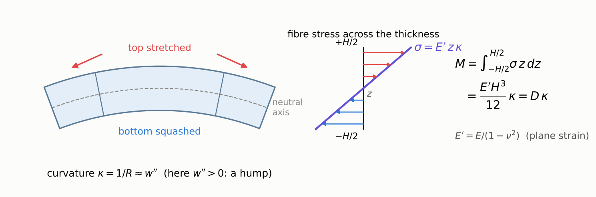

When the beam bends, cross-sections stay straight but tilt. A fibre at height $z$
above the mid-plane (the *neutral axis*) is stretched in proportion to its
distance from it:

$$
\varepsilon(z) = z\,\kappa ,\qquad \kappa = \frac{\partial^2 w}{\partial x^2}\quad\text{(the curvature)}.
$$

With $w$ positive down, $\kappa>0$ means a hump. The top is stretched (tension)
and the bottom squashed. Under the middle of a lake the ice sags, so
$\kappa<0$ and the top is in compression.

The **bending moment** is the turning effect of all the fibre stresses
$\sigma(z)$:

$$
M = \int_{-H/2}^{H/2} \sigma(z)\, z \, dz .
$$

#### Where $\varepsilon = z\kappa$ comes from

Here $z$ is measured **upwards** from the mid-plane, which keeps the sign conventions of §4. Under a lake the ice sags, so $\kappa = \partial^2 w/\partial x^2 < 0$ and the top is in compression.

Take a short piece of plate that subtends a small angle $d\theta$ at the centre of its bending arc. Under sag, that centre lies above the plate.

* The mid-plane sits at radius $R$, so its length is $R\,d\theta$.
* A fibre at height $z$ sits at radius $R-z$, so its length is $(R-z)\,d\theta$.

Strain is the change in length divided by the original length:

$$
\varepsilon = \frac{(R-z)\,d\theta - R\,d\theta}{R\,d\theta} = -\frac{z}{R}.
$$

With $|\kappa| = 1/R$ and $\kappa<0$ for sag, this is $\varepsilon = z\kappa$. The $d\theta$ cancels, so the strain depends only on the distance from the mid-plane and on how tightly the plate is bent.

Two assumptions carry this result.

* **Plane sections stay plane and normal to the mid-plane** (the Kirchhoff assumption). This neglects shear through the thickness, which is fine when the plate is thin compared with the bending wavelength, $k_x H \ll 1$.
* **The mid-plane keeps its length.** There is no net in-plane force, so $\int\sigma\,dz = 0$. With a uniform modulus, the zero-strain surface then sits at the mid-plane. A stiffness that varies with depth (a cold, stiff top and a warm, soft base) moves it.

For small slopes the exact curvature $\kappa = w''/[1+(w')^2]^{3/2}$ reduces to $\kappa \approx w''$.

#### The plane-strain modulus $E' = E/(1-\nu^2)$

For an isotropic elastic solid, each normal strain depends on all three normal stresses:

$$
\varepsilon_{xx} = \tfrac1E\big[\sigma_{xx}-\nu(\sigma_{yy}+\sigma_{zz})\big],\quad
\varepsilon_{yy} = \tfrac1E\big[\sigma_{yy}-\nu(\sigma_{xx}+\sigma_{zz})\big],\quad
\varepsilon_{zz} = \tfrac1E\big[\sigma_{zz}-\nu(\sigma_{xx}+\sigma_{yy})\big].
$$

Two conditions simplify these.

* **$\sigma_{zz}\approx 0$.** The top and base are nearly free. The real surface loads are of order $\rho g H$, far smaller than the bending stresses, which exceed them by roughly $(L/H)^2$, where $L$ is the bending wavelength.
* **$\varepsilon_{yy}=0$.** The plate is infinite and uniform in $y$, so neighbouring slices must deform identically. A fibre stretched in $x$ would like to contract in $y$, but its neighbours want to do the same, so that contraction is prevented.

Setting $\varepsilon_{yy}=0$ and $\sigma_{zz}=0$ in the $yy$ equation gives $\sigma_{yy} = \nu\,\sigma_{xx}$. Substituting into the $xx$ equation gives $\varepsilon_{xx} = \frac{1-\nu^2}{E}\sigma_{xx}$, that is,

$$
\sigma_{xx} = E'\,\varepsilon_{xx}, \qquad E' = \frac{E}{1-\nu^2}.
$$

The induced $\sigma_{yy}$ acts back on $x$ through $\nu$ a second time, which is why $\nu$ appears squared.

The size of the effect depends on the geometry. A narrow beam has free sides, so $\sigma_{yy}=0$ and its modulus is $E$. A wide plate has locked sides and modulus $E'$. For ice with $\nu\approx0.3$ the factor is $1.10$, a 10% correction to $D$ and under 3% to $\ell\propto D^{1/4}$. For an incompressible material ($\nu=\tfrac12$) it is $4/3$. This $E'$ is the modulus that enters $D$ below.

#### What $D$ is called

$D$ is the **flexural rigidity**, also called the *bending stiffness* or *plate rigidity*. It is the bending moment per unit width needed to produce unit curvature, $M = D\kappa$, and its units are N m, equivalently Pa m³. It is the plate version of $EI$ for a narrow beam.

In geophysics people often quote the **effective elastic thickness** $T_e$ instead. That is the value of $H$ that reproduces an observed $D$ through $D = EH^3/12(1-\nu^2)$. The viscous counterpart, $\Lambda = \eta H^3/3$, is called the **viscous flexural rigidity**; some notes write it $D_v$.

---

For an **elastic** beam in plane strain, $\sigma = E'\varepsilon$ with
$E' = E/(1-\nu^2)$. So

$$
M = E'\kappa \int_{-H/2}^{H/2} z^2\,dz = \frac{E' H^3}{12}\,\kappa \equiv D\,\kappa,
\qquad D = \frac{E H^3}{12(1-\nu^2)} .
$$

$D$ is the **flexural rigidity**. It scales as $H^3$, so a shelf twice as thick
is eight times as stiff.

For a **viscous** beam, stress depends on strain *rate*. For an incompressible
Newtonian fluid of viscosity $\eta$ in plane strain with $\sigma_{zz}\approx 0$,
this is $\sigma = 4\eta\,\dot\varepsilon$. The same integral gives

$$
M = \frac{4\eta H^3}{12}\,\dot\kappa \equiv \Lambda\,\dot\kappa,\qquad \Lambda = \frac{\eta H^3}{3} .
$$

$\Lambda$ is a "viscous flexural rigidity".

---

### Deriving the viscous factor $4\eta$

For an incompressible Newtonian fluid the stress is

$$
\sigma_{ij} = -p\,\delta_{ij} + 2\eta\,\dot\varepsilon_{ij},
$$

where $p$ is a pressure. In an incompressible fluid $p$ is not set by the deformation. It takes whatever value the constraints require. Three constraints apply in plane strain.

1. **Incompressibility:** $\dot\varepsilon_{xx}+\dot\varepsilon_{yy}+\dot\varepsilon_{zz}=0$.
2. **Plane strain:** $\dot\varepsilon_{yy}=0$.
3. **Free surfaces:** $\sigma_{zz}=0$.

From (1) and (2), $\dot\varepsilon_{zz} = -\dot\varepsilon_{xx}$. A fibre stretching in $x$ cannot narrow in $y$, so all the compensating contraction happens in $z$: the fibre thins vertically at the rate it lengthens.

From (3), $\sigma_{zz} = -p + 2\eta\dot\varepsilon_{zz} = 0$, so $p = 2\eta\dot\varepsilon_{zz} = -2\eta\dot\varepsilon_{xx}$. Then

$$
\sigma_{xx} = -p + 2\eta\,\dot\varepsilon_{xx} = 2\eta\dot\varepsilon_{xx} + 2\eta\dot\varepsilon_{xx} = 4\eta\,\dot\varepsilon_{xx}.
$$

This is the viscous counterpart of the elastic modulus $E'$: the same plane-strain stiffening, applied to a fluid. The thickness integral then gives $M = \int \sigma z\,dz = \tfrac{4\eta H^3}{12}\dot\kappa = \Lambda\dot\kappa$, with $\Lambda = \eta H^3/3$.

**Check.** A rod of incompressible fluid pulled at strain rate $\dot\varepsilon$ carries stress $3\eta\dot\varepsilon$, so the uniaxial viscous modulus is $3\eta$. Treat it like an elastic solid with $E\to 3\eta$ and $\nu\to\tfrac12$ in $E' = E/(1-\nu^2)$:

$$
\frac{3\eta}{1-\tfrac14} = 4\eta .
$$

This agrees with the plane-strain factor used above.

**Caveat.** Uniform $\eta$ is assumed. For real ice $\eta$ depends strongly on temperature, so $\Lambda = \int 4\eta(z)\,z^2\,dz$ about the neutral surface. The neutral surface moves towards the stiff, cold top, and the effective rigidity is dominated by the coldest layers.

---

## 5. Ice is a Maxwell material

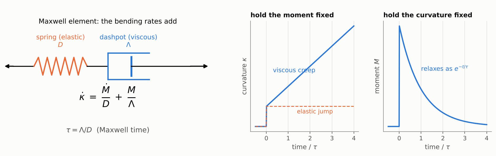

Over minutes to hours, ice behaves like a spring. Over days to weeks it creeps
like a very stiff fluid. The simplest model that does both is a **Maxwell
element**, a spring and a dashpot in series. Each fibre obeys
$\dot\varepsilon = \dot\sigma/E' + \sigma/4\eta$. Multiply by $z$ and integrate
across the thickness, exactly as above, and the *bending* rates simply add:

$$
\boxed{\;\dot\kappa = \frac{\dot M}{D} + \frac{M}{\Lambda}\;}
\qquad\Longleftrightarrow\qquad
\dot M = D\,\dot\kappa - \frac{M}{\tau},
\tag{2}
$$

with the **Maxwell time**

$$
\tau = \frac{\Lambda}{D} = \frac{4\eta(1-\nu^2)}{E} .
$$

For $\nu\to\tfrac12$ this becomes the familiar $\eta/G$, where $G$ is the shear
modulus. With $E = 1$ GPa and $\eta = 10^{14}$ Pa s, $\tau \approx 4.2$ days.
The right-hand plots show the two classic experiments:

* **Hold $M$ fixed.** $\kappa$ jumps elastically and then creeps linearly.
* **Hold $\kappa$ fixed.** $M$ jumps and then relaxes as $e^{-t/\tau}$.

A useful mental picture is an **elastic beam whose stress-free shape slowly
drifts towards whatever shape it is being held in**.

### Why the two rates add (series, not parallel)

The Maxwell element is a spring and a dashpot joined end to end, so both carry the same stress and their extensions add. For one fibre,

$$
\dot\varepsilon = \frac{\dot\sigma}{E'} + \frac{\sigma}{4\eta},
$$

with the spring giving $\dot\varepsilon_e = \dot\sigma/E'$ and the dashpot giving $\dot\varepsilon_v = \sigma/4\eta$.

This arrangement matches how ice behaves.

* **Sudden load.** The dashpot cannot move instantly, so the spring takes all the load and the response is immediately elastic.
* **Sustained load.** The dashpot keeps extending for as long as stress remains, so the ice flows indefinitely.

A parallel arrangement (Kelvin–Voigt) adds the stresses instead. It creeps towards a fixed elastic strain and then stops, which is not what ice does.

The bending kinematics apply to the total strain, because plane sections stay plane: $\varepsilon = z\kappa$, so $\dot\varepsilon = z\dot\kappa$. Substituting this into the Maxwell law and integrating over the thickness, with the weighting $z$, gives $\dot\kappa = \dot M/D + M/\Lambda$. That is equation (2). The curvature rates add because the total curvature rate is the sum of an elastic rate, $\dot M/D$, and a viscous rate, $M/\Lambda$.

**What this means.**

* The moment sets the *rate* of bending, not the curvature itself. A constant moment makes the curvature grow linearly in time, with no equilibrium shape. That is why the viscous plate keeps sagging until buoyancy takes over the whole load.
* The units differ: $\Lambda$ is in Pa s m³ and $D$ in Pa m³. So $\Lambda/D$ is a time, the Maxwell time $\tau$.
* Uniform $\eta$ is assumed, as in the viscous factor above.

### Two Poisson's ratios, two relaxation times

So far the spring and the dashpot share the same sideways behaviour. They
should not. Elastically, ice has a Poisson's ratio $\nu \approx 0.3$. Creep,
however, conserves volume, so the viscous part behaves as if its Poisson's
ratio were $\nu_v = \tfrac12$ (as in MacAyeal et al., 2021, and Bézu et al.,
2025). A single spring–dashpot pair cannot have two Poisson's ratios.

The fix comes from the plate's full moment tensor. Split it into an
**isotropic** part (equal bending in every direction) and a **deviatoric** part
(more bending one way than the other).

* The elastic stiffnesses of the two parts are $D(1+\nu)$ and $D(1-\nu)$.
* The viscous ones are $\Lambda(1+\nu_v)$ and $\Lambda(1-\nu_v)$.
* Each part is its own Maxwell element.

A beam in plane strain ($\kappa_{yy} = 0$) bends both parts, with weights
$(1\pm\nu)/2$. Its moment is therefore the sum of **two Maxwell elements in
parallel**:

$$
M = M_1 + M_2,\qquad \dot M_i = D_i\,\dot\kappa - \frac{M_i}{\tau_i},
\qquad D_{1,2} = D\,\frac{1\pm\nu}{2},
\tag{2'}
$$

$$
\tau_1 = \tau\,\frac{1+\nu_v}{1+\nu} = \frac{4\eta(1+\nu_v)(1-\nu)}{E},\qquad
\tau_2 = \tau\,\frac{1-\nu_v}{1-\nu} = \frac{4\eta(1-\nu_v)(1+\nu)}{E}.
$$

For $\nu_v = \tfrac12$ these are $\tau_1 = 6\eta(1-\nu)/E \approx 4.9$ days and
$\tau_2 = 2\eta(1+\nu)/E \approx 3.0$ days. Four checks:

* **Elastic limit:** $M = (D_1 + D_2)\kappa = D\kappa$, as before.
* **Viscous limit:** $M = (D_1\tau_1 + D_2\tau_2)\dot\kappa = \Lambda\dot\kappa$, the same viscous rigidity as before.
* **Mean time:** the rigidity-weighted mean $(D_1\tau_1 + D_2\tau_2)/D$ is still $\tau = \Lambda/D \approx 4.2$ days.
* **Equal Poisson's ratios:** if $\nu_v = \nu$ the two times are equal and (2′) collapses back to the single element (2).

In map view the same split gives the viscous plate law
$M = \Lambda\big[(1-\nu_v)\dot{\boldsymbol\kappa} + \nu_v\,\mathrm{tr}(\dot{\boldsymbol\kappa})\,I\big]$.
For $\nu_v=\tfrac12$ this is exactly the viscous bending law used by MacAyeal
et al. (2021) and Bézu et al. (2025).

### Relation to MacAyeal, Sergienko & Banwell (2015)

MacAyeal et al. (2015) wrote down the thin-plate viscoelastic model of
ice-shelf flexure under meltwater lakes, motivated by the 2002 break-up of the
Larsen B Ice Shelf. Physically, the model in this document is the same one.

**Same framework.** One bending-moment field drives an elastic spring and a
viscous dashpot in series, and the plate floats on sea water. Their
"buoyancy bucket" is our bed of springs, $k=\rho_{sw}g$.

**Same plate laws.** They split the curvature
$\mathbf H = (\kappa_{xx}, \kappa_{yy}, \kappa_{xy})$ into elastic and viscous
parts, driven by the same moment $\mathbf M = (M_{xx}, M_{yy}, M_{xy})$:

$$
\dot{\mathbf H} = \mathbf D^{-1}\dot{\mathbf M} + \mathbf V^{-1}\mathbf M,
\qquad
\mathbf D = D\begin{pmatrix}1&\nu&0\\ \nu&1&0\\ 0&0&1-\nu\end{pmatrix},
\qquad
\mathbf V = \Lambda\begin{pmatrix}1&\tfrac12&0\\ \tfrac12&1&0\\ 0&0&\tfrac12\end{pmatrix}.
$$

This is their eqs 17–19. It is written here in our notation and sign
convention: their displacement is positive upwards, their viscosity is our
$\eta$, and $\Lambda=\eta H^3/3$. $\mathbf D$ is our elastic plate law, and
$\mathbf V$ is our viscous plate law with $\nu_v=\tfrac12$.

**Our two relaxation times are their equation, diagonalised.** $\mathbf D$
and $\mathbf V$ share three eigenvectors: isotropic bending $(1,1,0)$,
deviatoric bending $(1,-1,0)$ and twist $(0,0,1)$. Their eigenvalues are
$D(1+\nu)$, $D(1-\nu)$, $D(1-\nu)$ and $\Lambda(1+\nu_v)$,
$\Lambda(1-\nu_v)$, $\Lambda(1-\nu_v)$. In that basis the matrix equation
falls apart into independent Maxwell elements, $\dot M = d\,\dot\kappa - M/\tau$,
with

$$
\tau_1 = \frac{\Lambda(1+\nu_v)}{D(1+\nu)}\ \ \text{(isotropic)},\qquad
\tau_2 = \frac{\Lambda(1-\nu_v)}{D(1-\nu)}\ \ \text{(deviatoric and twist)},
$$

which are the times of (2′). Any model with one moment field and two
Poisson's ratios therefore has two relaxation times; (2′) just makes them
explicit.

**Their experiment, rerun.** They filled a circular lake, 500 m in radius
and 2 m deep, on a 200 m thick shelf ($E = 10$ GPa, $\nu = 0.3$) over 60
days, drained it in 6 hours, and followed the shelf for a year. Their ice
obeys Glen's law with $n=3$. The table repeats this with `SpectralPlate`
(a 25.6 km periodic box at 50 m, exact in time) for three constant
viscosities. It gives the depression at the lake centre; their values are
read from their Figs 4 and 5.

| | day 60 (full) | just after drainage | day 365 |
|---|---|---|---|
| MacAyeal et al. (2015), Glen's law $n=3$ | 58 cm | 36 cm | 19 cm |
| this model, $\eta = 5\times10^{13}$ Pa s | 150 cm | 126 cm | 0.4 cm |
| this model, $\eta = 3\times10^{14}$ Pa s | 83 cm | 63 cm | 4.0 cm |
| this model, $\eta = 2\times10^{15}$ Pa s | 41 cm | 21 cm | 3.5 cm |

The elastic jump when the water leaves agrees. Ours is the purely elastic
response to the lake, 19.8 cm, plus up to 4 cm of creep during the 6 hours
of drainage when $\eta$ is low; theirs is about 22 cm. The recovery does not
agree. With a constant viscosity the centre recovers to within a few
centimetres over the following year, and no single value of $\eta$ matches
both their filling and their recovery. Under Glen's law the effective
viscosity rises as the stresses fall, so their recovery stalls with 19 cm
still to go. Their suggestion that repeated fill–drain cycles deepen lake
basins year after year therefore rests on the nonlinear rheology.

**Differences.**

* *Rheology.* They offer Glen's law, through an effective viscosity built
  from the invariants of $\mathbf M$ (their eqs 39–40). Here $\eta$ is
  constant (see §13).
* *Parameters.* They take $E = 10$ GPa; here $E = 1$ GPa, from tidal
  flexure. For the same $\eta$ that makes $\ell$ about 1.8 times shorter and
  $\tau$ 10 times longer.
* *Unknowns and numerics.* They solve for $\mathbf M$, the viscous
  curvature and the deflection (seven unknowns) with COMSOL finite elements,
  and demonstrate one axisymmetric lake with a simply supported edge at
  $r = 10$ km. Here the 1-D beam uses the scheme of §11. The 2-D plates carry
  two scalar moment potentials instead of the tensor (see
  [`viscoelastic_plate.py`](viscoelastic_plate.py)), solved by finite
  differences with grounded ice held fixed, or by FFTs exactly in time.
* *Thickness.* Their tensor form takes spatially varying thickness and
  viscosity as it stands. The moment potentials need a uniform rigidity in
  2-D (see §13).
* *Scope.* They study one idealised lake for one year. Here lakes are routed
  by fill-spill-merge on real REMA surfaces, with grounding lines, and the
  routing can be coupled to the flexure.

---

## 6. The master equation

Now combine the force balance (1) with the material law. Take $\partial^2/\partial x^2$
of each Maxwell law in (2′), add them, and use (1) differentiated in time,
$\dot M'' = \dot q - k\dot w$:

$$
\dot q - k\,\dot w \;=\; D\,\frac{\partial^4\dot w}{\partial x^4}
\;-\; \frac{\partial^2}{\partial x^2}\Big(\frac{M_1}{\tau_1} + \frac{M_2}{\tau_2}\Big).
$$

Rearranged:

$$
\boxed{\;\Big(D\,\frac{\partial^4}{\partial x^4} + k\Big)\frac{\partial w}{\partial t}
= \frac{\partial q}{\partial t} + \frac{\partial^2}{\partial x^2}\Big(\frac{M_1}{\tau_1} + \frac{M_2}{\tau_2}\Big)\;}
\tag{3}
$$

When the two times are equal ($\nu_v = \nu$), the last term is $M''/\tau$. By (1)
that is $(q-kw)/\tau$, and (3) becomes the **single-element master equation**

$$
\Big(D\,\frac{\partial^4}{\partial x^4} + k\Big)\frac{\partial w}{\partial t}
= \frac{\partial q}{\partial t} + \frac{q - k\,w}{\tau}.
\tag{3'}
$$

Read (3′) left to right:

* The operator in brackets is the **elastic** beam-on-springs operator.
* $\partial q/\partial t$ is the **instantaneous elastic** response to any change in load.
* $(q-kw)/\tau$ is the **creep** term. Wherever buoyancy is not yet carrying the
  lake ($kw\neq q$), the ice creeps at a rate set by $\tau$, and it stops only
  when $kw = q$.

The full equation (3) says the same thing, except that the two parts of the
bending moment creep away at slightly different rates.

---

### Assumptions behind the master equation

* **Thin plate.** The plate is much thinner than the load width, $k_x H\ll1$. This fails for narrow lakes on thick shelves (see §8.5).
* **Small slopes.** The geometry is linear, with $\kappa\approx w''$.
* **No in-plane force.** An axial force would add a term $N\,\partial^2 w/\partial x^2$ to the equation.
* **Plane strain.** The geometry is a 2-D strip, infinite in $y$.
* **Quasi-static.** Inertia is neglected.
* **Uniform properties.** $H$, $E$ and $\eta$ are uniform. Temperature-dependent viscosity makes the viscous rigidity depth-weighted rather than $\eta H^3/3$.

Read these with the master equation (3′) in mind. Each one is an assumption about the plate or the load. None of them is a claim about what happens after the load changes.

---

## 7. Two limits: elastic and isostatic

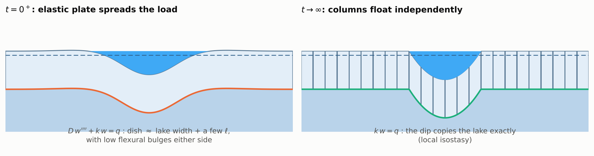

**At $t = 0^+$ the response is elastic.** Integrate (3) across the instant the
load appears. The creep term is finite, so it contributes nothing in zero time,
and we are left with

$$
D\,\frac{\partial^4 w}{\partial x^4} + k\,w = q .
$$

This is the classic "beam on elastic foundation" (Hetényi, 1946). Its natural
length scale is the **flexural length**

$$
\ell = \left(\frac{D}{k}\right)^{1/4} \approx 610\ \text{m}\quad(H = 250\ \text{m},\ E = 1\ \text{GPa}).
$$

For a line load $P$ the solution is
$w = \frac{P\beta}{2k}\,e^{-\beta|x|}\big(\cos\beta|x| + \sin\beta|x|\big)$, with $\beta = 1/(\sqrt2\,\ell)$.

* The dip is spread over a few flexural lengths.
* It crosses zero at $|x| = 3\pi\ell/(2\sqrt2) \approx 3.3\ell$.
* A low **flexural bulge** peaks at $|x| = \sqrt2\,\pi\,\ell \approx 4.4\ell$, with
  height $e^{-\pi}\approx 4\%$ of the central dip.

Our 3 km-wide, 4 m-deep lake sinks the centre by 3.2 m at first, instead of 3.9 m.

**As $t\to\infty$ the response is isostatic.** Once nothing changes any more
($\dot w = 0$), each Maxwell law makes its $M_i$ decay to zero, so (1) gives $q = k w$. The ice "forgets" its stiffness
and floats as independent columns. The dip copies the lake exactly, and the
bending moment relaxes to zero.

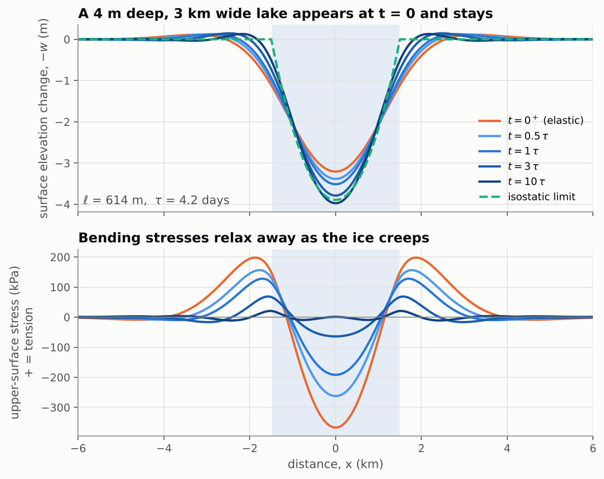

*A lake appears at $t=0$ and is left there. The orange curve is the elastic
response. The blue curves (light to dark) show the ice creeping towards the
dashed isostatic shape. The bending stresses (bottom panel) decay as it does.*

---

## 8. Which shapes relax first? The relaxation spectrum

Because the equations are linear with constant coefficients, each sinusoid in $x$ evolves on its own. A load with any shape can be split into sinusoids, each relaxes at its own rate, and the total response is their sum. This section derives the rate for one sinusoid, shows what it means, and compares this route with the real-space solution.

### 8.1 One wavelength, step by step

Put $w = \hat w(t)\cos k_x x$ and $q = \hat q\cos k_x x$, with $\hat q$ switched on at $t=0$ and held constant. Since $\partial_x^4\cos k_x x = k_x^4\cos k_x x$, and $\partial_t q = 0$ for $t>0$, the single-element master equation (3′) becomes an ordinary differential equation:

$$
\big(Dk_x^4 + k\big)\,\frac{d\hat w}{dt} = \frac{\hat q - k\,\hat w}{\tau}.
$$

**Step 1: the gap.** Define the shortfall from isostasy,

$$
y(t) \equiv \hat w(t) - \frac{\hat q}{k}.
$$

It is negative while the plate has not yet sunk far enough.

**Step 2: rewrite.** $\hat q$ is constant for $t>0$, so $\hat q/k$ is constant too, and $dy/dt = d\hat w/dt$.

**Step 3: substitute.** Since $\hat q - k\hat w = -k\,y$,

$$
\big(Dk_x^4+k\big)\frac{dy}{dt} = -\frac{k}{\tau}\,y
\quad\Longrightarrow\quad
\frac{dy}{dt} = -\frac{y}{\tau_\lambda},
\qquad
\tau_\lambda = \tau\,\frac{Dk_x^4+k}{k} = \tau\big[1+(k_x\ell)^4\big],
$$

using $\ell^4 = D/k$. The gap closes at a rate proportional to its own size.

**Step 4: solve.** Separating variables and integrating gives $y(t) = y_0\,e^{-t/\tau_\lambda}$, where $y_0$ is the gap at the moment creep starts.

**Step 5: the starting gap.** Creep starts just after the elastic jump, when $\hat w(0^+) = \hat q/(Dk_x^4+k)$. So

$$
y_0 = \frac{\hat q}{Dk_x^4+k} - \frac{\hat q}{k}.
$$

This is negative: the elastic deflection falls short of isostasy because bending carries part of the load.

**Step 6: back to deflection.**

$$
\hat w(t) = \underbrace{\frac{\hat q}{k}}_{\text{isostatic}}
+ \Big(\underbrace{\frac{\hat q}{Dk_x^4+k}}_{\text{elastic}} - \frac{\hat q}{k}\Big)\,e^{-t/\tau_\lambda}.
$$

**Step 7: checks.** At $t=0^+$ the exponential is 1, and the result is the elastic value. As $t\to\infty$ the exponential vanishes, and the result is isostatic. After one $\tau_\lambda$ the shortfall has fallen to $1/e \approx 37\%$ of its starting size. In the right-hand panel of the relaxation-spectrum figure, each curve starts at its elastic value and closes that fraction of the gap per $\tau_\lambda$.

**What it means.**

* **Broad features** ($\lambda \gg 2\pi\ell$) are barely supported by bending in the first place. They are already nearly isostatic, and what is left relaxes in about one Maxwell time.
* **Narrow features** ($\lambda \lesssim 2\pi\ell$) are held up mainly by the ice's stiffness. They relax extremely slowly, as $(2\pi\ell/\lambda)^4$. On a 250 m-thick shelf, a 2 km-wavelength wiggle takes about two months to relax, and a 1 km one takes more than two years (thin-plate values; see §8.5).

### 8.2 Two Poisson's ratios

The elastic and viscous Poisson's ratios differ, so one wavelength is not a single Maxwell element. It is two coupled elements, one for each Poisson's ratio, and each wavelength therefore relaxes as the sum of two exponentials. Their exact form is a $2\times2$ matrix exponential per mode (`relaxation_times` and `modal_step_response` in the code). The left panel of the figure shows both times.

* The **slow mode** stays within 15% of $\tau_\lambda$, and within 1% for narrow features. It carries most of the creep.
* The **fast mode** has a time of 3.0–3.5 days. It carries up to about a third of the (already small) relaxation of broad features, and almost none of the relaxation of narrow ones.

With two Poisson's ratios there is no single $\tau$, so the figure normalises by a mean Maxwell time. That is why the deflection hardly changes. The right panel's dotted lines are the single-element model.

This also tells us that the problem is **not stiff** numerically. The fastest decay rate of any mode is $1/\tau_2$ (about 3 days), so a time step of a fraction of a day is enough for every wavelength.

### 8.3 Code for one mode

The response of one mode is a single function. This is the form used for the plots in this section.

```python
import numpy as np

def w_hat(t, kx, q_hat, k, D, tau):
    """Amplitude of the cos(kx x) mode after a step load q_hat switched on at t = 0."""
    ell = (D / k) ** 0.25
    w_iso = q_hat / k                       # isostatic, t -> infinity
    w_el = q_hat / (D * kx**4 + k)          # elastic jump, t = 0+
    tau_l = tau * (1 + (kx * ell) ** 4)     # relaxation time of this mode
    return w_iso + (w_el - w_iso) * np.exp(-t / tau_l), tau_l
```

Pass an array of wavelengths as `kx` to get the relaxation spectrum. The function's second output, `tau_l`, is the same $\tau_\lambda$ as above. Its validity depends on $k_xH$; see §8.5.

### 8.4 Two routes to the same elastic response

The elastic response to a load can be found in two ways. The Fourier route is an algebraic shortcut. The real-space route gives the shape of the deflection around one particular load. Both give the same physics.

**The Fourier route: algebra rather than calculus.** A cosine passes through $\partial_x^4$ unchanged apart from a factor $k_x^4$. Substituting $w = \hat w\cos k_xx$ into $Dw''''+kw=q$ turns the differential equation into an algebraic one:

$$
\big(Dk_x^4 + k\big)\,\hat w = \hat q
\quad\Longrightarrow\quad
\hat w = \frac{\hat q}{Dk_x^4 + k} = \frac{\hat q/k}{1+(k_x\ell)^4}.
$$

No boundary conditions, symmetry arguments or force balance need to be applied. They are all built into the choice of a sinusoid on an infinite plate, which is bounded, has the right symmetry, and needs no patching. The result is a **transfer function**, the plate's response to each wavelength. It is a low-pass filter:

* **Long wavelengths** pass through at the isostatic value, $\hat q/k$.
* **Short wavelengths** are suppressed as $(k_x\ell)^{-4}$, because bending holds them up.

**The real-space route: an explicit shape.** Here the work is:

1. find the roots of $Dm^4 + k = 0$;
2. assemble the four decaying and oscillating solutions;
3. discard the growing ones;
4. apply symmetry, $w'(0)=0$;
5. apply the force condition, $\int k\,w\,dx = P$.

This takes more work, but what comes out is a **shape**. For a line load $P$,

$$
w = \frac{P\beta}{2k}\,e^{-\beta|x|}\big(\cos\beta|x| + \sin\beta|x|\big), \qquad \beta = \frac{1}{\sqrt2\,\ell}.
$$

Step 4 fixes the constant. For $x>0$ write $w = e^{-\beta x}(A\cos\beta x + B\sin\beta x)$. Near $x=0$ the $A$ term falls with slope $-\beta$, and the $B$ term rises with slope $+\beta$, so $w'(0) = \beta(B-A)$. Symmetry requires $w'(0)=0$, which gives $B=A$. The $B$ term does not change the height at the load, but it tilts the plate, and $B=A$ makes the upward tilt cancel the downward one so the base is flat at the load.

From the shape you can read off the dip, the zero crossing at $\beta x = 3\pi/4$ (that is, $|x| \approx 3.3\,\ell$), and the forebulge at $\beta x = \pi$ (that is, $|x|\approx 4.4\,\ell$). You also get closed forms for a lake of width $W$. Its centre deflection, in units of the isostatic deflection, is $1 - e^{-\beta W/2}\cos(\beta W/2)$, and at the shoreline the deflection is half the isostatic value. None of these is visible in the transfer function.

**How they connect.** The Green's function is the inverse Fourier transform of the transfer function. A point load contains every wavelength equally, so $\hat q = P$ for all $k_x$, and

$$
w(x) = \frac{1}{2\pi}\int_{-\infty}^{\infty}\frac{P}{Dk_x^4+k}\,e^{ik_xx}\,dk_x .
$$

Doing this integral by contour integration moves the work into finding the poles, where $Dk_x^4+k=0$. With $m = ik_x$ these are the same complex roots $\beta(\pm1\pm i)$ as in real space. Closing the contour in the upper half-plane picks out the two decaying roots. This is the Fourier counterpart of discarding the growing exponentials. Both routes do the same work, and the Fourier route simply defers it to the inversion step.

Each real-space condition has a Fourier counterpart:

| Real-space step | Fourier counterpart |
|---|---|
| Drop growing exponentials | Bounded sinusoids; contour closed on the correct side |
| Symmetry, $w'(0)=0$ | Cosines are already symmetric |
| $\int k\,w\,dx = P$ | The $k_x = 0$ mode: $\hat w(0) = \hat q(0)/k$ |
| Forebulge | Ringing from the filter's sharp roll-off at $k_x\ell\approx1$ |

The force condition says something general. The zero-wavenumber mode is always isostatic, so **the total displaced volume is always load$/k$, whatever the stiffness**. Bending redistributes the deflection but cannot change its total. That is also why the forebulge exists: in the point-load solution the dip is deeper and wider than the load alone would need, and the bulge pays back the difference.

**When each is the right tool.**

* **Fourier** is better when time-dependence matters. Each mode becomes its own ODE, which gives the relaxation spectrum $\tau_\lambda$ almost for free, as in §8.1. It is also the natural way to see which scales dominate a load.
* **Real space** is better when you want the shape of one load: the depth of the dip, the zero crossing, the forebulge, or closed forms for a particular lake.
* **Boundaries.** The Fourier route assumes an infinite plate. A grounding line or calving front breaks that assumption, so those ends are handled with real-space conditions (§10).

### 8.5 Applying the spectrum to lakes, and thin-plate validity

**$\lambda$ is not lake width.** A lake of width $W$ corresponds roughly to $\lambda \approx 2W$. So a "1 km wiggle" corresponds to a lake about 500 m across.

**The thin-plate condition.** Everything in this section assumes $k_xH \ll 1$. At $\lambda = 1$ km on 250 m ice, $k_xH \approx 1.6$, which is already marginal. As $k_xH$ grows, the beam increasingly overestimates $\tau_\lambda$. The $\lambda^{-4}$ steepening is a thin-plate artefact. The exact layer solution in the code turns over to half-space scaling, $\tau_\lambda \propto \eta\lambda$, instead. So for narrow lakes on thick shelves the values in §8.1 are overestimates, and the thin-plate form should be checked against the full solution.

---

## 9. Stresses, and why draining is dangerous

The bending stress is largest at the upper surface, where crevasses open:

$$
\sigma_{\text{top}} = \frac{6M}{H^2}\qquad(\text{positive} = \text{tension}).
$$

For the 4 m-deep, 3 km-wide lake:

* The elastic response puts the surface under the lake centre into compression of about $-370$ kPa.
* A ring of **tension, about $+200$ kPa**, sits just outside the lake shore.
* These stresses are of the same order as those usually needed to open surface
  crevasses, roughly 100 kPa or more (e.g. Vaughan, 1993).

This is the "ring fracture" mechanism proposed for the 2002 Larsen B break-up
(Banwell et al., 2013).

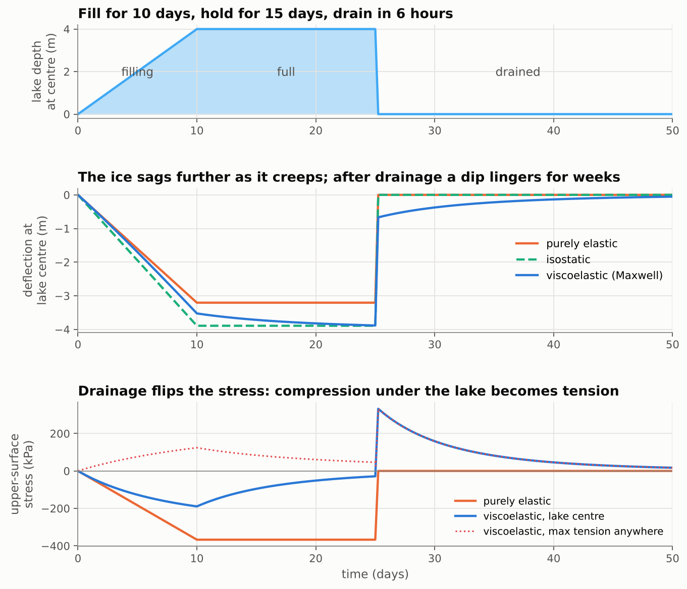

The viscoelastic twist comes with **drainage**:

* **While the lake sits**, the moments relax ($M\to 0$). The ice "gets used to"
  being bent.
* **When the lake drains** in hours (for example by hydrofracture), the load
  vanishes much faster than $\tau$. The response to *removing* the load is
  again elastic, and equal and opposite to the original elastic response.
  Superposed on a relaxed state, this leaves the ice **bent upwards**, with the
  surface under the former lake now in **tension (+330 kPa)**.
* A dip of about 0.7 m lingers at the old lake site and creeps away over the
  following weeks.

Repeated fill-drain cycles therefore reverse the stress at the lake centre
again and again. This fatigue-like loading is what the model was built to
explore (compare MacAyeal & Sergienko, 2013; Banwell et al., 2019).

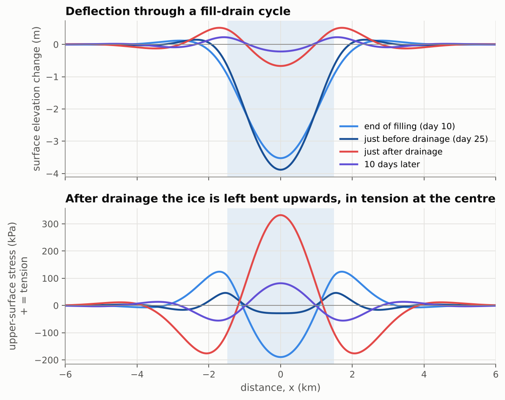

---

## 10. Boundary conditions

The beam equation is fourth order, so each end needs **two** conditions.

| end | physical meaning | conditions | type |
|---|---|---|---|
| **grounding line** | ice frozen to the bed: no deflection, no tilt | $w = 0,\;\; \partial w/\partial x = 0$ ("clamped") | kinematic: on $w$ |
| **calving front** | nothing holds the end | $M = 0,\;\; V = \partial M/\partial x = 0$ ("free") | dynamic: on $M$ |

The free-end conditions are on $M$, not directly on $w$. For a Maxwell beam
that starts from rest, $M = 0$ for all time implies $\partial^2 w/\partial x^2 = 0$
for all time, and similarly for the third derivative, so the elastic intuition carries over.

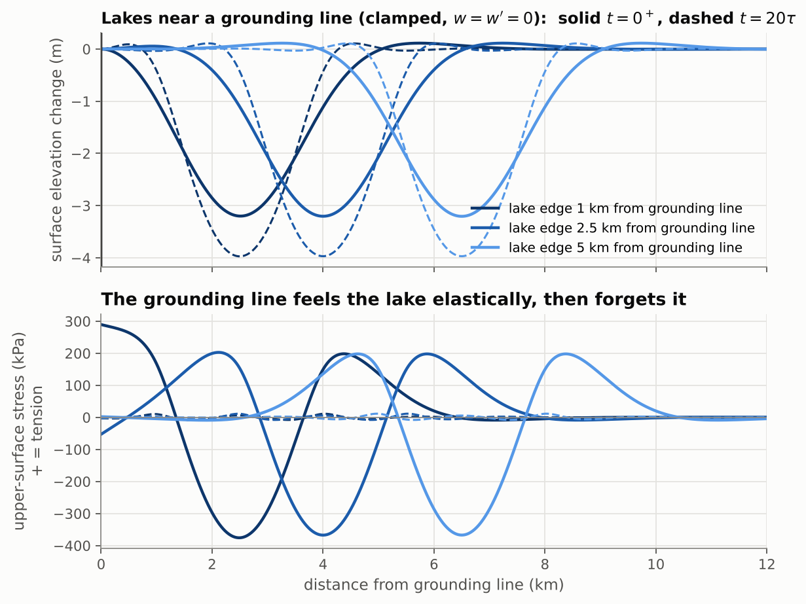

*Lakes 1, 2.5 and 5 km from a clamped grounding line. A lake within about
$2\ell$ of the grounding line strains it elastically: here, +290 kPa of surface
tension at the grounding line for the closest lake. That stress relaxes away
(dashed curves) as the shelf creeps.*

---

## 11. Numerics: fast and simple

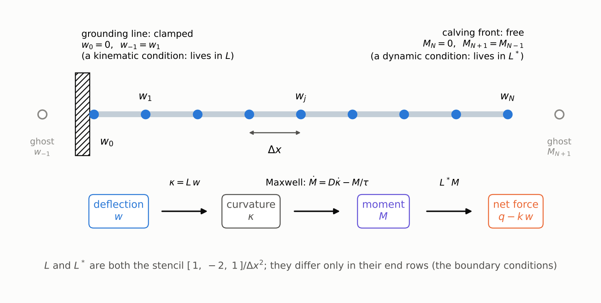

### Space: two little matrices

Put $N$ equally spaced nodes $x_j$ along the beam, with spacing $\Delta x$, and
store $w_j$ and $M_j$ at each node. The physics is a chain of three steps:

$$
w \;\xrightarrow{\;L\;}\; \kappa \;\xrightarrow{\;\text{Maxwell}\;}\; M \;\xrightarrow{\;L^*\;}\; \text{net force } (q - k w).
$$

Both $L$ and $L^*$ are the familiar second-difference stencil
$[\,1,\,-2,\,1\,]/\Delta x^2$. They differ **only in their end rows**, which is
where the boundary conditions live:

| end type | row of $L$ (curvature from $w$) | row of $L^*$ (force from $M$) |
|---|---|---|
| clamped (node 0) | ghost $w_{-1}=w_1$: $\;\kappa_0 = (2w_1-2w_0)/\Delta x^2$ | not used: the equation is replaced by $w_0 = 0$ |
| free (node 0) | not used: zeros, so $M_0 \equiv 0$ | ghost $M_{-1}=M_1$: $\;f_0 = (2M_1-2M_0)/\Delta x^2$ |

Kinematic conditions go in $L$ and dynamic ones go in $L^*$. The fourth
derivative is never written down explicitly. It is just $L^* D\, L$, so a
spatially varying $D(x)$ (a thinning shelf) costs nothing extra.

### Time: the trapezoidal rule, then one linear solve

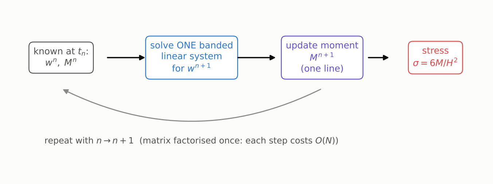

Step from $t_n$ to $t_{n+1} = t_n + \Delta t$. For each part $i = 1, 2$ write
$a_i = \Delta t/\tau_i$ and $c_i = 1/(1 + a_i/2)$.

**1. Moment update.** Apply the trapezoidal (Crank–Nicolson) rule to each
Maxwell law $\dot M_i = D_i L\dot w - M_i/\tau_i$ at every node:

$$
M_i^{n+1} = c_i\,\Big[(1-\tfrac{a_i}2)\,M_i^n + D_i\,L\,(w^{n+1}-w^n)\Big].
$$

**2. Deflection solve.** Substitute these into the force balance at the new
time, $L^*(M_1^{n+1} + M_2^{n+1}) + k\,w^{n+1} = q^{n+1}$. This gives **one
linear system** for the new deflection, with $\bar D = c_1D_1 + c_2D_2$:

$$
\big(\underbrace{L^* \bar D\,L + k\,I}_{\text{constant, pentadiagonal}}\big)\,w^{n+1}
= q^{n+1} + L^* \bar D\,L\,w^n - L^*\Big[\textstyle\sum_i c_i\,(1-\tfrac{a_i}2)\,M_i^n\Big].
$$

**3. Repeat.** Solve step 2 for $w^{n+1}$, then evaluate step 1 for each $M_i^{n+1}$.

That is the entire algorithm. In the code it reads (`Mp0` holds the two parts,
and `c`, `a` have one row per part):

```python
def step(self, w0, Mp0, q1, dt):
    lu, S, c, a = self._step_matrices(dt)          # S = L* (c1 D1 + c2 D2) L, factorised once
    rhs = q1 + S @ w0 - self.Lstar @ (c * (1 - a/2) * Mp0).sum(axis=0)
    w1 = self._solve(lu, rhs)                       # one banded back-substitution
    Mp1 = c * ((1 - a/2) * Mp0 + self.Dp * (self.L @ (w1 - w0)))
    return w1, Mp1
```

### Why this is a good scheme

* **Fast.** The matrix never changes, so it is factorised once. Each step is
  then one banded back-substitution costing $O(N)$. 3000 nodes × 1200 steps
  take about one second in pure Python and SciPy.
* **Exact elastic limit.** With $\Delta t/\tau \to 0$ it reduces to the elastic
  solve, so instantaneous loading and unloading are captured exactly.
* **Second-order accurate** in both $\Delta x$ and $\Delta t$, and
  **unconditionally stable**: the trapezoidal rule is A-stable.
* **Force balance holds to round-off at every step.** The two operators are used
  consistently, so the discrete version of (1) is satisfied exactly, and the
  stresses are physically consistent.
* **Choosing steps.** $\Delta x \lesssim \ell/10$ and $\Delta t \lesssim \tau_2/10$
  give errors well below 0.1 % (see the convergence panel below).

---

## 12. Verification

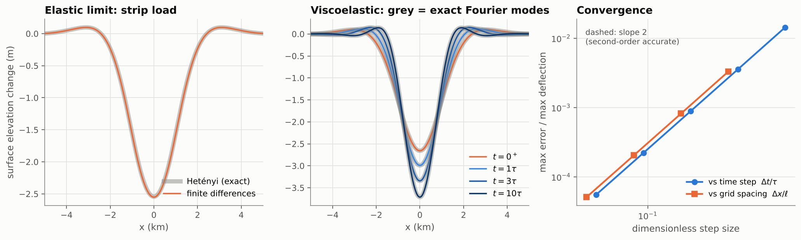

The test-suite ([`tests/test_viscoelastic_beam.py`](tests/test_viscoelastic_beam.py),
run with `python -m pytest -q`) checks the model against exact solutions:

| test | exact solution | agreement |
|---|---|---|
| elastic strip load, free beam | Hetényi (1946) | < 0.2 % |
| line load at a free calving front | $w = \frac{2P\beta}{k}e^{-\beta x}\cos\beta x$ | < 0.2 % |
| uniform load, clamped grounding line | $w = \frac{q}{k}\big[1 - e^{-\beta x}(\cos\beta x + \sin\beta x)\big]$ (the tidal-flexure profile) | < 0.1 % |
| viscoelastic relaxation of a lake | exact Fourier-mode solution (§8, two-element) | < 0.2 % |
| equal Poisson's ratios | the single-element closed form $\tau_\lambda = \tau[1+(k\ell)^4]$ | to round-off |
| moment tensor in map view | $D[(1-\nu)\kappa + \nu\,\mathrm{tr}\,\kappa\,I]$ elastically, $\Lambda[(1-\nu_v)\dot\kappa + \nu_v\,\mathrm{tr}\,\dot\kappa\,I]$ when viscous | $<10^{-4}$ |
| long-time limit | local isostasy $w = q/k$, $M\to0$ | ✓ |
| uniform load on a free beam | no bending at all | to round-off |
| discrete force balance $L^*M + kw = q$ | (all boundary-condition combinations) | to round-off |
| time convergence | slope 2 | ✓ |

---

## 13. Limitations and easy extensions

* **Lake–flexure feedback.** In this document the water depth is prescribed.
  In reality the lake sits in the depression it creates. The routing
  notebooks couple the plate to fill-spill-merge, so water and ice shape each
  other:
  * [`lake_drainage_flexure.ipynb`](lake_drainage_flexure.ipynb) drains a
    routed lake;
  * [`coupled_routing_flexure.ipynb`](coupled_routing_flexure.ipynb) routes a
    melt season over the flexing shelf;
  * [`drainage_reorganisation.ipynb`](drainage_reorganisation.ipynb) follows
    where the next summer's water goes after a lake drains.
* **Variable thickness.** In 1-D this already works: pass `H` as an array.
  Both $D$ and $\Lambda$ scale as $H^3$, so $\tau$ is unchanged. The 2-D plates
  need a uniform thickness, because their moment potentials assume a uniform
  rigidity. Carrying the moment tensor instead, as MacAyeal et al. (2015) do,
  removes that restriction at about the same cost.
* **Lakes in map view.** This is implemented in
  [`viscoelastic_plate.py`](viscoelastic_plate.py): the same physics with
  $\partial^4/\partial x^4 \to \nabla^4$ gives a viscoelastic plate. A round
  lake sinks less than a long trough at first, and the ring of tension survives.
  See Part 3 of [`flexure_model_tutorial.ipynb`](flexure_model_tutorial.ipynb).
* **Nonlinear (Glen's law) creep and depth-varying temperature.** Here
  $\eta$ depends on stress and depth, so $\Lambda$ becomes a function of the
  state. The moment update becomes a local nonlinear update; the solve stays
  the same. MacAyeal et al. (2015, eqs 39–40) give a ready-made effective
  viscosity in terms of the bending moments. It is what keeps their lake basin
  from recovering after drainage (§5).
* **Membrane stresses and ice-shelf flow.** These are neglected, which is fine
  for bending over days to weeks. For coupled flow and flexure see
  MacAyeal et al. (2021).
* **Thin-plate validity for narrow lakes.** The beam results assume $k_xH \ll 1$. At $\lambda = 1$ km on 250 m ice, $k_xH \approx 1.6$. There the beam overestimates $\tau_\lambda$, and the $(2\pi\ell/\lambda)^4$ scaling becomes unreliable (§8.5).
* **Fracture.** The model reports stresses but does not break.

---

## 14. Parameters and references

| symbol | meaning | default |
|---|---|---|
| $H$ | ice thickness | 250 m |
| $E$ | effective Young's modulus (tidal-flexure studies infer about 1 GPa, well below the laboratory 9 GPa; e.g. Vaughan, 1995) | 1 GPa |
| $\nu$ | elastic Poisson's ratio | 0.3 |
| $\nu_v$ | Poisson's ratio of viscous creep (incompressible) | 0.5 |
| $\eta$ | ice viscosity | $10^{14}$ Pa s |
| $\rho_i,\ \rho_{sw},\ \rho_w$ | ice, sea water, meltwater densities | 917, 1028, 1000 kg m⁻³ |
| $D = EH^3/12(1-\nu^2)$ | flexural rigidity | $1.4\times10^{15}$ N m |
| $k = \rho_{sw}g$ | buoyancy stiffness | $1.0\times10^4$ Pa m⁻¹ |
| $\ell = (D/k)^{1/4}$ | flexural length | 614 m |
| $\tau = 4\eta(1-\nu^2)/E$ | mean Maxwell time | 4.2 days |
| $\tau_1 = 4\eta(1+\nu_v)(1-\nu)/E$ | relaxation time, isotropic part | 4.9 days |
| $\tau_2 = 4\eta(1-\nu_v)(1+\nu)/E$ | relaxation time, deviatoric part | 3.0 days |

The values of $E$ and especially $\eta$ are uncertain by an order of magnitude
or more. Treat the numbers above as illustrative. Because $\ell \propto E^{1/4}H^{3/4}$
and $\tau \propto \eta/E$, it is easy to rescale the results.

* Banwell, A. F., MacAyeal, D. R., & Sergienko, O. V. (2013). Breakup of the Larsen B Ice Shelf triggered by chain reaction drainage of supraglacial lakes. *Geophysical Research Letters*, 40, 5872–5876.
* Banwell, A. F., Willis, I. C., Macdonald, G. J., Goodsell, B., & MacAyeal, D. R. (2019). Direct measurements of ice-shelf flexure caused by surface meltwater ponding and drainage. *Nature Communications*, 10, 730.
* Bézu, C., Lipovsky, B. P., Shapero, D. R., & Banwell, A. F. (2025). Ice shelf evolution combining flow, flexure, and fracture. *Journal of Glaciology*, 71, e112.
* Hetényi, M. (1946). *Beams on Elastic Foundation*. University of Michigan Press.
* Holdsworth, G. (1969). Flexure of a floating ice tongue. *Journal of Glaciology*, 8(54), 385–397.
* MacAyeal, D. R., & Sergienko, O. V. (2013). The flexural dynamics of melting ice shelves. *Annals of Glaciology*, 54(63), 1–10.
* MacAyeal, D. R., Sergienko, O. V., & Banwell, A. F. (2015). A model of viscoelastic ice-shelf flexure. *Journal of Glaciology*, 61(228), 635–645. doi:10.3189/2015JoG14J169
* MacAyeal, D. R., Sergienko, O. V., Banwell, A. F., Macdonald, G. J., Willis, I. C., & Stevens, L. A. (2021). Treatment of ice-shelf evolution combining flow and flexure. *Journal of Glaciology*, 67(265), 885–902.
* Reeh, N., Christensen, E. L., Mayer, C., & Olesen, O. B. (2003). Tidal bending of glaciers: a linear viscoelastic approach. *Annals of Glaciology*, 37, 83–89.
* Turcotte, D. L., & Schubert, G. (2014). *Geodynamics* (3rd ed.). Cambridge University Press.
* Vaughan, D. G. (1993). Relating the occurrence of crevasses to surface strain rates. *Journal of Glaciology*, 39(132), 255–266.
* Vaughan, D. G. (1995). Tidal flexure at ice shelf margins. *Journal of Geophysical Research*, 100(B4), 6213–6224.
